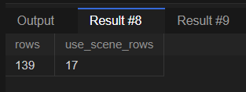

# Q1（#58）文の辞書の確認と精度（DS-04 手順3〜6、TC-21）

## 手順3：CSV の全行の確認（2026-11-15）

- 対象：`giftia/backend/sql/review_sentences.csv`（PR #64 の案。139行）
- 形：空欄・重複なし。polarity・use_scene の値は決めた値だけ。最長32文字（100文字以下）
- 直した行の数：**3行**（139行中）。いずれも use_scene を 1 → 0

| 文 | 直す前 | 直した後 | 理由（SP-19） |
| --- | --- | --- | --- |
| 飲みやすかったと聞きました | positive / 1 | positive / 0 | 味の評価だけ。「味もおいしかったと聞きました」（0）とそろえる |
| ほんのり香る程度で、使いやすいです | positive / 1 | positive / 0 | 書いた人の評価だけで、受け取った人の暮らしの様子がない |
| 早めに食べる必要があるので、在宅の日を聞いてから送りました | none / 1 | none / 0 | 贈る側の配送の段取り。「日持ちはしないので、到着日を相手の予定に合わせました」（0）とそろえる |

- 直した後の use_scene ＝ 1 の行：17行

## 手順4：SQL を作る

- `python tools/sentences.py sql` → 「139行の SQL を作った」

## 手順5：SQL を流す

- Slack での班の了承：2026-11-15 21:10、あかぷさんが了承（[Slack のスレッド](https://tech-0.slack.com/archives/C0ABHFW9Z3M/p1794744631592439?thread_ts=1792501310.149029&cid=C0ABHFW9Z3M)）
- 流した人：べー（MySQL Workbench、`feature/issue-58-sentence-check` の `002_review_sentences.sql`）
- 結果：`rows` ＝ 139（期待 139）、`use_scene_rows` ＝ 17（期待 17）→ 一致

## 手順6：精度（TC-21・SP-20）

- 合格の基準：無作為の20件のうち、センチメント（4分類）かハイライトの誤りが2件以下
- 20件の選び方：手順5 で流した `002_review_sentences.sql` の末尾の SELECT（`ORDER BY RAND() LIMIT 20`。本文のあるレビューから無作為に20件）の結果をそのまま使った
- 「辞書の判定」は、本文を「。」で分け、文の辞書を引いて機械的に出した（辞書にない文は0件）。「誤り」の列は、べーが本文を読んで決める

| # | review_id | 本文 | 辞書の判定：センチメント | 辞書の判定：ハイライト | 誤り |
| --- | --- | --- | --- | --- | --- |
| 1 | RV0002062 | 毎年お中元に贈っています。迷ったらこれ、という感じの品です。満足しています。 | ポジティブ | なし | なし |
| 2 | RV0008621 | 紹介してくださった方へのお礼に。常温で置いておけるので、相手の都合を気にせず渡せました。次もここで選びます。 | ポジティブ | なし | なし |
| 3 | RV0007321 | 毎年お歳暮に贈っています。一箱にまとめて入っているので、配る用途には向かないかもしれません。価格を考えると十分だと思います。 | 混在 | なし | なし |
| 4 | RV0010812 | 祖母に贈りました。定番の品なので、安心して贈れました。また選ぶと思います。 | ポジティブ | なし | なし |
| 5 | RV0000845 | 親戚へのお中元に選びました。冷蔵庫に入れなくていいのは助かったと言われました。おおむね満足です。 | ポジティブ | 冷蔵庫に入れなくていいのは助かったと言われました | なし |
| 6 | RV0021759 | 取引先へのお礼に。置き場所に困らない大きさでした。普通によかったです。 | ポジティブ | 置き場所に困らない大きさでした | なし |
| 7 | RV0001305 | 叔母へのお中元に。常温で置いておけるので、相手の都合を気にせず渡せました。満足しています。 | ポジティブ | なし | なし |
| 8 | RV0007015 | 毎年お歳暮に贈っています。一つずつ包まれていて、取り分けやすかったです。選んでよかったです。 | ポジティブ | 一つずつ包まれていて、取り分けやすかったです | なし |
| 9 | RV0015659 | 離れて暮らす母へ。包装がていねいでした。次もここで選びます。 | ポジティブ | なし | なし |
| 10 | RV0004294 | 祖母に贈りました。しっかりした作りです。また選ぶと思います。 | ポジティブ | なし | なし |
| 11 | RV0005540 | 長い付き合いの友人に贈りました。実用的で、もらって困らないものだと思います。定番の品なので、安心して贈れました。満足しています。 | ポジティブ | なし | なし |
| 12 | RV0023841 | 地元の友人の誕生日に。置き場所に困らない大きさでした。実用的で、もらって困らないものだと思います。悪くはないですが、特別感は少なめでした。 | 混在 | 置き場所に困らない大きさでした | なし |
| 13 | RV0011855 | 母の誕生日に。迷ったらこれ、という感じの品です。冷蔵庫に入れなくていいのは助かったと言われました。相手にも喜んでもらえました。 | ポジティブ | 冷蔵庫に入れなくていいのは助かったと言われました | なし |
| 14 | RV0012821 | 恩師へのお中元に。常温で置いておけるので、相手の都合を気にせず渡せました。おおむね満足です。 | ポジティブ | なし | なし |
| 15 | RV0016530 | 取引先へのお礼に。写真のとおりの品でした。また選ぶと思います。 | ポジティブ | なし | なし |
| 16 | RV0002883 | 地元の友人の誕生日に。置き場所に困らない大きさでした。また利用したいです。 | ポジティブ | 置き場所に困らない大きさでした | なし |
| 17 | RV0017869 | 趣味仲間の誕生日に。置き場所に困らない大きさでした。悪くはないですが、特別感は少なめでした。 | 混在 | 置き場所に困らない大きさでした | なし |
| 18 | RV0004964 | 紹介してくださった方へのお礼に。見た目もきれいでした。相手にも喜んでもらえました。 | ポジティブ | なし | なし |
| 19 | RV0007864 | プロジェクトでお世話になった方に。職場で渡すのにちょうどよかったです。価格を考えると十分だと思います。 | ポジティブ | なし | なし |
| 20 | RV0000287 | 恩師へのお中元に。上品な味だったそうです。とても満足しています。 | ポジティブ | なし | なし |

- 誤りの件数：0件 → 合否：**合格**（基準は2件以下。2026-11-15、べーが20件を読んで判定）
- 判断が分かれた文：「置き場所に困らない大きさでした」（#6・#12・#16・#17）は、置き場所という言葉が受け取った人の家に置く場面を前提にし、置いている様子が浮かぶため、use_scene ＝ 1 で正しいと判断した
