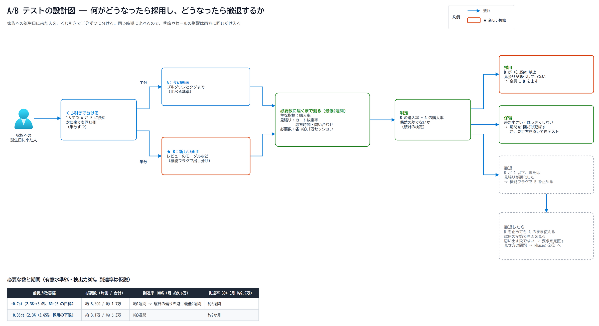
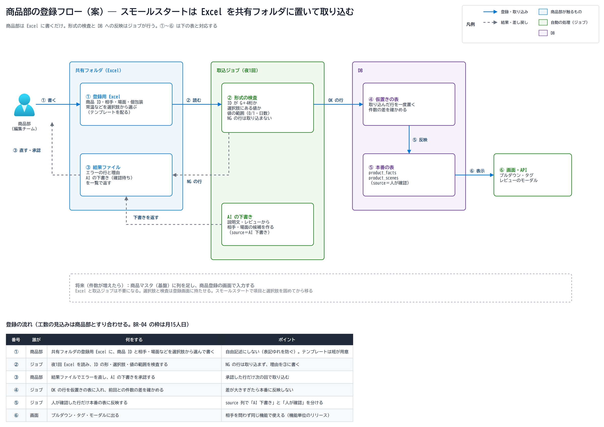
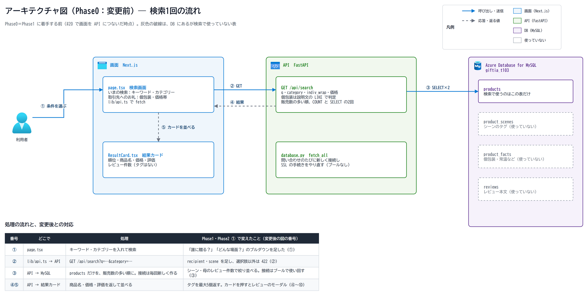
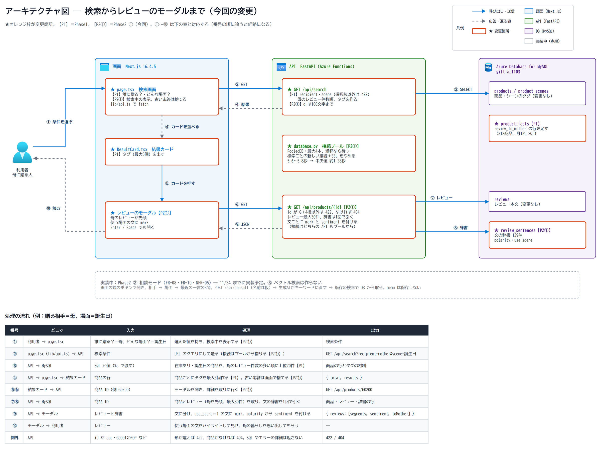
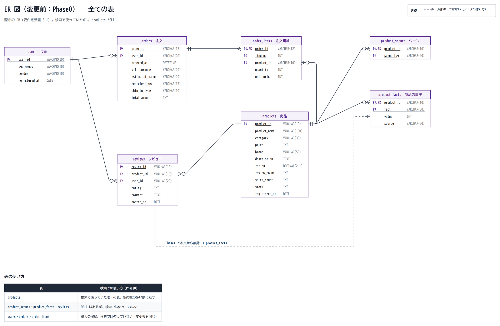
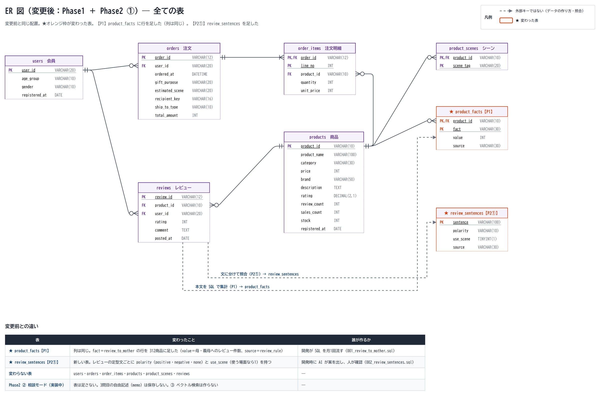
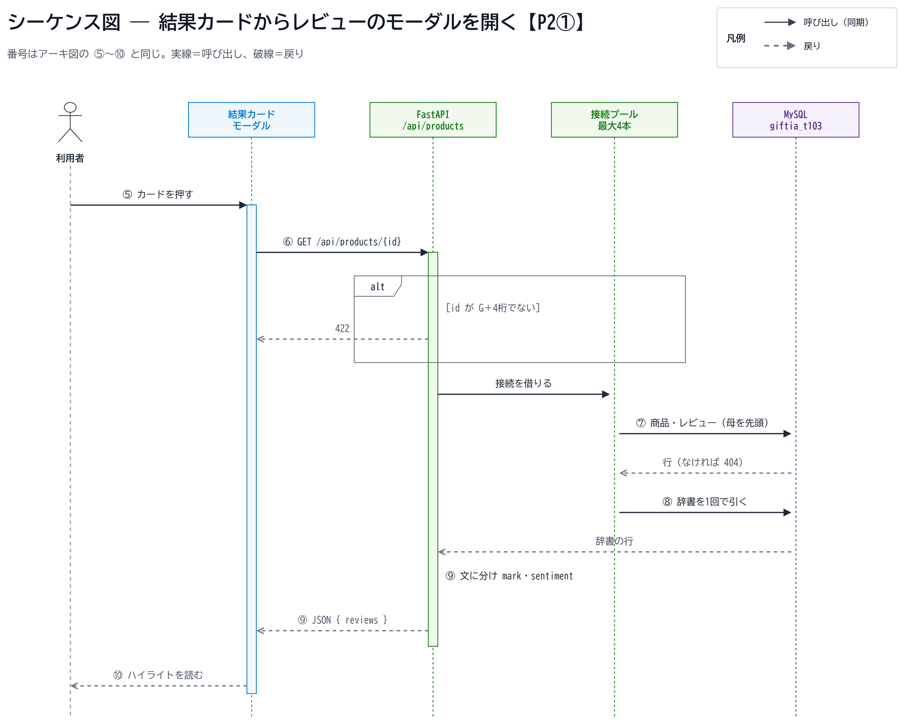

# Giftia 改善企画書 ― 社長のお題への回答

2026-11-22 作成。発表は7分。レビュー役は副社長・バックエンドエンジニア・データベースエンジニア。正本は要求定義書・要件定義書（2026-11-22 の #92 まで反映）。

## 0. 結論と、決めていただきたいこと

**社長のお題**：機能の話から始めず、Giftia を使っている人が何に困っているか、まず何を解決すべきかを定義すること。2か月後までに、何を作るべきかを要求と要件にまとめて提案すること。実装は一部でよい。

**投資仮説（1文）**：家族の誕生日に贈る人が、相手の一言や関心を Giftia の中で思い出せるようになれば、このシーンの購入率が 2.3% から 3.0% に近づき、売上が年 約650万円（基準のケース）から 約4,355万円（上振れ）増える。

### 決めていただきたいこと

| # | 判断 | 範囲・期間・人 |
| --- | --- | --- |
| 1 | 本番に向けて進めることを、条件付きで承認する | 条件は、試用で兆しが見えること（6.1）と、商品部が登録の工数に合意すること（9.3） |
| 2 | 次の一歩に着手する | 2026-12 に商品部とのすり合わせ（班・商品部）。2027-01 から開発部への引き継ぎ |
| 3 | A/B テストの判定者と撤退ラインを、この場で合意する | 撤退ラインは 6.2（B が A 以下、または見張る指標が悪化）。判定者は案として副社長 |

| 工程 | やったこと | 結果（要点） | 章 |
| --- | --- | --- | --- |
| VOC の収集 | 5人の購買行動（Exhibit 2）と定量データ（Exhibit 1） | 品揃えではなく「選べない」が主因 | 1 |
| 課題の設定 | 5つの候補を、困り度・広さ・単価で比べた | 家族への誕生日、思い出し型の人 | 2 |
| 要求 | 顧客要求2つ、事業要求2つ | 購入率 2.3%→3.0%（BR-03） | 3 |
| 解決策の比較 | 記事・ランキング・検索条件などの他の打ち手と比べた | 既存の資産（レビュー・シーン）で小さく始められる案を選んだ | 4 |
| 要件定義・仕様設計・一部の実装 | Phase1、Phase2 ①を実装。②（相談モード）は 11/24 までに実装中 | テストは PASS。検索は 5.6秒→約1.3秒 | 5〜7 |
| 検証 | 試作は試用で、本番は A/B テストで確かめる | 顧客への効果は未確認。採用と撤退の基準は決めた | 6 |
| 投資判断 | 事実と仮定を分け、3つのケースで試算 | 下振れでも試作の開発費は小さい | 8 |
| 今後のフロー | ゲートごとの段取り | 試用 → 商品部 → 開発部 → A/B テスト | 9 |

## 1. VOC の収集：何に困っているか

セッションは増えたのに売上が伸びない。数字と顧客の行動を読むと、原因は品揃えではなく「選べないこと」だった。

### 定量（Exhibit 1。すべて事実）

- セッション 375万→480万（+28%）に対し、売上は 6.41億→6.91億円（約+8%）
- 購入率 3.6%→3.0%、カート投入率 12%→8%、詳細閲覧は 6.2→9.4商品、購入までの日数は 1.8→3.1日
- CS 問い合わせの最多は「商品の選択・用途」31%。「見つからない」は 4%、検索結果0件率は 2.1%
- 全ての流入経路で購入率が下がっており、流入経路も主因とは読みにくい

### 顧客の声と行動（Exhibit 2、5人）

発言ではなく、実際の行動と決め手を見た。

| 顧客 | 言ったこと | 実際の行動・決め手 | 読み取ったこと |
| --- | --- | --- | --- |
| A（先輩への送別） | 条件を入れたら人気商品を出してほしい | 10商品以上見て離脱。同僚の賛同で購入 | 決め手はサイトの外（同僚の合意） |
| B（友人への誕生日） | 予算で絞れるのが一番大事 | 翌日 Instagram で見つけた品を購入 | 発見が Giftia の外にある |
| C（取引先へのお礼） | 好みに合うものを勧めてほしい | 常温・個包装などを確かめて購入 | 迷ってはいるが離脱していない |
| D（母への誕生日） | 母の年代で人気のものが分かると助かる | ランキングを見ても決められず離脱。数日後、母の「こういうの便利そうね」を思い出して購入 | 言ったこと（人気）と決め手（母の一言）が違う |
| E（お中元・お歳暮） | 去年と同じものが確実に届けばよい | 前年と同じ品を購入 | 課題がない |

D さんは「何も手掛かりがないから、まず人気を見るんです」と話した。実際には、母の一言という手がかりを持っていた。持っているのに、それを手がかりだと自覚していなかった。

## 2. 課題の設定：まず何を解決すべきか

**採用した課題（仮説）**：相手が使い続けてくれるものを贈りたいのに、相手の手がかり（とくに具体的な一言や関心）を持っていながら、それを手がかりだと自覚していない。そのため人気に頼るしかないと思い、ランキングでは「この人が使いそう」と思える理由を持てず、購入を保留している。

| 候補 | 困り度（Exhibit 1 表2） | 広さ | 採否と理由 |
| --- | --- | --- | --- |
| D：家族への誕生日 | 購入率 2.3%、閲覧 10.8商品、3.8日 | 構成比 24%（約115.2万セッション）、単価 5,400円 | 採用。困り度が高く、対象が広く、単価も高い |
| A：送別 | 購入率 1.7%（最低）、16.5商品、5.3日 | 構成比 18% | 不採用。決め手が同僚の合意で、サイトの外にある |
| B：友人への誕生日 | 購入率 2.8%（全体並み） | — | 不採用。発見が SNS にある別の課題 |
| C：取引先へのお礼 | 購入率 4.0% | — | 不採用。手間はあるが離脱していない |
| E：毎年の贈答 | 購入率 5.0% | — | 不採用。課題がない |

**課題の大きさと確からしさは分けて見る。** 大きさ（115.2万セッション・単価 5,400円）は事実だ。確からしさの根拠は D さん1人の行動で、薄い。そのため、課題は「仮説」と書き、試用（6.1）と A/B テスト（6.2）の2段で確かめる。

対象は「思い出し型」（相手の話を思い出せないと決められない人）に絞った。人気や件数で決める「安心型」は、Phase1 のタグで足りると考えている。

## 3. 要求：何を実現したいか

**提供価値**：贈る相手について自分が持っている手がかりを Giftia の中で思い出し、それと結びつけて、相手が使ってくれそうだと思える品を選べる。

| ID | 区分 | 要求 | 優先度 |
| --- | --- | --- | --- |
| BR-01 | 顧客要求 | 商品を探している間に、相手の手がかり（過去の一言や暮らしの場面）を思い出せる | 高 |
| BR-02 | 顧客要求 | 思い出した手がかり（相手・場面）を条件にして候補を絞り、相手が使いそうかで選べる | 高 |
| BR-03 | 事業要求 | 家族への誕生日の購入率を 2.3% → 3.0%（全体平均）に上げる | 高 |
| BR-04 | 事業要求 | 新商品が増えても、手がかりのデータを商品部（月5人日）と編集（月10人日）の工数で付け続けられる | 中 |

## 4. 解決策の比較：なぜこの打ち手か

同じ工数で、他の打ち手と比べた。

| 打ち手 | 効く範囲 | 弱いところ | 判断 |
| --- | --- | --- | --- |
| 特集記事を増やす | 記事に触れたセッションの購入率は 4.1% と高い | 想定150通りのうち、記事でカバーできるのは約40通り。1本3人日で、残り110通りには届きにくい | 補う手段として残す |
| ランキングを変える | 全員の目に入る | D さんはランキングを見ても決められなかった。人気は「この人が使いそう」の理由にならない | 採らない |
| 検索条件（相手・場面）を足す | 検索を使う人に必ず見える | 条件だけでは思い出すきっかけが弱い | Phase1 として作った |
| 他の人のレビューを見せる | 母に贈ったレビューは 312商品 | 他の人の使用感で、本人の一言には直接働かない | Phase2 ①として作った |
| 相手本人について問いかける（相談モード） | 生成AIを使いたい人 | 費用・毎回答えが変わる問題・AI の暴走 | Phase2 ②として作っている（制御は 7.3） |

**なぜ Giftia がやるのか**：推薦の仕組みは、生成AIで誰でも作れる。差がつくのは、Giftia にしかないデータと、それを更新し続ける運用だ。今回の案は、Giftia にある9種類のシーンのタグと、「母に贈った」と書かれたレビュー本文（425件・312商品）を使っている。さらに、贈った相手と用途の分かる注文（orders の recipient_key・gift_purpose）もあり、相手を広げるときに使える（今回は未使用）。

## 5. 作ったもの：Phase0 から何が変わったか

| 観点 | Phase0（変更前） | Phase1（実装済み） | Phase2 ①（実装済み） | Phase2 ②（11/24 までに実装中） |
| --- | --- | --- | --- | --- |
| 探し方 | キーワード・カテゴリー、販売数の多い順 | 「誰に贈る？」「どんな場面？」のプルダウン。母へのレビューが多い順 | 同左 | 相談モードを選べる（FR-10）。相手 → 場面 → 最近の一言の3問 |
| 思い出すきっかけ | なし | 結果カードのタグ（最大5個） | カードを押すとモーダル。母に贈った人のレビューを先頭に、使う場面の文をハイライト | 「最近『欲しい』『便利そう』と言っていたものは？」と問いかける |
| データ | products だけを使う | product_facts に review_to_mother（312商品） | review_sentences（139件） | 新しい表は作らない。memo は保存しない |
| API | `/api/search` | recipient・scene を足し、選択肢以外は 422 | `/api/products/{id}` | `/api/consult`（名前は仮） |
| 検索の速さ | — | Azure で 5.6〜5.8秒 | 接続プールで約1.28秒 | — |

③ベクトル検索は今回は作らない（#92、確認事項 11）。図は Appendix B〜D に、変更前と変更後を並べて載せた。

### 実装した範囲と、していない範囲

| 状態 | 中身 |
| --- | --- |
| 実装・テスト済み | Phase1（TC-01〜12）、Phase2 ①（TC-15〜19・25・28）、接続プール（#85） |
| 実装中（11/24 予定） | Phase2 ② 相談モード（FR-08・FR-10・NFR-05、テスト P2-11〜18）。発表のときに動くかは未確認 |
| 作らない・後回し | ③ベクトル検索。検索 1秒の目標（Phase3 以降へ申し送り）。相手を父・友人に広げること（本番前に行う。9.1） |

## 6. 検証：効果をどう確かめるか

### 6.1 試作の検証（試用。発表まで）

| 項目 | 内容 |
| --- | --- |
| 確かめること | 思い出し型の人が、相手の一言や関心を思い出し、それと結びつけた理由を持って品を選べるか |
| やり方 | 3〜6人。母がいる人に「お母さんの誕生日プレゼントを1つ決めてください」と頼む。予算 3,000〜6,000円、時間をそろえる。ランキングの画面と新しい画面の両方で決めてもらい、半分の人は順番を逆にする |
| 見る指標 | ① 品を決められたか ② 理由を母の一言や暮らしと結びつけて言えたか ③ 自信（1〜5） ④ 思い出し型か安心型か。クリック数や滞在時間は、迷う人ほど増えて良し悪しを読めないため使わない |
| 外れたと判断する条件 | 新しい画面でも、母の一言と結びついた理由が出てこない。または「評判がよいから」だけで選ぶ |
| 状態 | 未確認。1回目（#55）は記録用紙を用意した段階 |

試作の合格は「兆しを見た」までとし、証明したとは言わない。

### 6.2 本番の検証（A/B テスト）

**かんたんに言うと**：来た人をくじ引きで2つの組に分ける。片方には今の画面（A）、もう片方には新しい画面（B）を見せる。同じ時期に比べるので、季節やセールの影響は両方に同じだけ入る。終わったら「B の組のほうが、たくさん買ったか」を比べる。

| 項目 | 決めたこと（案） |
| --- | --- |
| 分け方 | 1人ずつ A か B に決め、次に来ても同じ側にする。新しい機能は機能フラグで出し分ける |
| 主な指標 | 家族への誕生日の購入率（BR-03）。1人あたりの購入率もあわせて見る |
| 見張る指標 | カート放棄率、検索の応答時間、CS の「選択・用途」の問い合わせ、ほかの導線（記事・ランキング）からの購入率 |
| 食い合いの見方 | くじ引きで分けるので、B の組の増加分は純増と読める。あわせて、B の組で記事・ランキングからの購入が減っていないかを見る |
| 期間と数 | 必要数に届くまで、最低2週間。+0.35pt を見分けるには片側 約3.1万セッション（到達率 30% なら約2か月） |
| 採用 | B の購入率が A より +0.35pt 以上高く、偶然の差でない。見張る指標も悪化していない → 全員に B を出す |
| 撤退 | B が A 以下、または見張る指標が悪化 → 機能フラグで B を止める。A はそのまま使える |
| 撤退したら | 思い出す段の問題でなければ、要求を見直す（候補 A の送別など別の課題へ）。見せ方の問題なら、モーダルと相談モードの組み合わせを変える |
| 前提として要るもの | 行動のログ。いまの DB には閲覧・検索語・表示・離脱の記録がない。A/B の組と購入を結べるログを、本番の開発で足す（9.2） |

## 7. 設計の要点：データと API（DB・バックエンドの観点）

### 7.1 データモデルと、その持ち方を選んだ理由

| 論点 | 答え |
| --- | --- |
| 何をどこに持つか | 商品の事実は product_facts（product_id・fact・value・source）に1行1事実で持つ。母へのレビュー件数（review_to_mother）もここに足し、表と列は増やしていない。文の辞書は review_sentences（sentence が主キー）に持つ |
| なぜその持ち方か | 既存の「商品の事実」の形にそのまま乗り、既存の行と列に手を触れずに済む（後方互換）。source 列で作り方（review_rule・AI の下書き・人が確認）を分けられる |
| 既存データへの影響 | 既存の fact の行は変えていない。追加の SQL は fact＝review_to_mother の行だけを消して入れ直す。列の追加がないので、マイグレーションは要らない |
| なぜ MySQL か | 開発条件（Exhibit 5）で、既存の Azure Database for MySQL を使うと決まっている。既存の DB をそのまま使えば、データの移し替えが要らない |
| キーと制約 | product_facts の主キーは（product_id, fact）で、1商品1事実を保証する。review_sentences には polarity と use_scene に CHECK 制約がある。product_facts の value には CHECK がない（技術負債。9.2） |
| 不明・いいえ・0 の区別 | 個包装などは、行がない＝不明、value＝0＝いいえ、1＝はい と分けている。一方で、評価（rating）が NULL の商品を API は 0 として返している（技術負債。9.2） |
| 二重持ち | products の rating・review_count・sales_count と、review_to_mother は、元のデータ（reviews・注文）の集計を別に持っている。速さのための意図的な選択で、ずれないよう月1回作り直す。本番ではジョブにする |
| 少ない件数の偏り | 並び順は評価の平均ではなく、母へのレビュー件数 → 販売数 → 商品 ID。1件だけの星5が上に来ることはない。ただし、母のレビューは 312商品のうち 258商品が1件だけで、思い出すきっかけとしては弱い |
| 出どころの追跡 | source 列で、誰がどう作ったかは分かる。いつ作ったか（更新日時）の列はない（技術負債。9.2） |

### 7.2 画面の操作と SQL の対応、性能

| 画面の操作 | API | SQL（すべてプレースホルダー %s で値を渡す） |
| --- | --- | --- |
| 相手・場面を選んで検索 | `GET /api/search` | 件数（COUNT）→ 上位20件（相手を選んだら product_facts を LEFT JOIN）→ タグの材料を2回でまとめて取る。計4回、接続は1本 |
| 結果カードを押す | `GET /api/products/{id}` | 商品 → レビュー（母を先頭、最大30件）→ 文の辞書を `IN (...)` で1回。計3回 |
| 相談モードで3問に答える | `POST /api/consult`（仮） | 生成AIがキーワードに直したあと、既存の検索の SQL を使う。商品は DB からだけ取る |

- **速さ**：検索1回 約5.4秒のうち、接続が約4.6秒（1.14秒×4回）だった。DB の中は 0.17秒（約3%）。そこで、インデックスより先に接続プールで使い回し、約1.28秒にした（目標 1秒は Phase3 以降へ申し送り）
- **件数が増えたら**：products は 8,000件で全件を読んでいる（EXPLAIN で確認。DB の中 73ms）。件数が10倍になると全件の読み込みも増えるため、絞り込みに使う列（stock・category・price）と、product_facts の（fact, value）にインデックスを検討する。インデックスは登録が遅くなる代償があるので、EXPLAIN で効く列だけに張る
- **行が増えて数え間違えないか**：シーンの絞り込みは JOIN ではなく EXISTS にしたので、1商品に複数のシーンがあっても行が増えない。タグの材料は商品ごとに引かず、まとめて取る（N+1 を避ける）

### 7.3 API の入出力・エラー・安全

| 場面 | 動き |
| --- | --- |
| 正常 | `{ total, results }` を返す。total は条件に合う全件数で、results は上位 limit 件（既定 20）。並び順は最後に商品 ID で決まるので、同点でも毎回同じ順になる |
| 0件 | 200 で空の一覧を返す（エラーとは分ける）。画面は「上位 0 件」と出し、カードは出ない。0件のときの案内文はなく、改善の候補 |
| 選択肢にない値、長すぎる q、形の違う ID | 422 を返し、画面は「検索の条件を確かめてください」と出す。商品がない ID は 404 で、モーダルに「商品が見つかりませんでした」と出す。どちらも SQL やスタックトレースは返さない（TC-19） |
| API につながらない | 画面に「APIにつながりません」を出す。古い応答は捨て、検索中を表示する（#61） |
| 生成AIが失敗した・0件だった（②） | 相手と場面だけで探した結果を返す。止まらない（P2-18） |
| 生成AIの暴走（②） | 質問の文と順番は固定。AI は DB にある語の一覧からキーワードを選ぶだけで、商品は DB から取る。外部のリンクは出さない。同じ入力には同じ結果を返す（NFR-05、P2-14・15） |
| 秘密情報 | DB の接続情報と API キーは `.env` と関数アプリの環境変数だけに置き、画面側には置かない。DB の証明書（DB_SSL_CA）で相手を確かめる |
| CORS | `.env` の CORS_ORIGINS に書いた画面の URL から、GET だけを許可する（②の POST を足すときに直す） |
| 個人情報 | 相談モードの3問目（memo）は保存しない。会員の個人情報（年代・性別）は使っていない。パスワードの列は DB にない |

## 8. 投資判断：費用と効果

### 8.1 効果（事実と仮定を分ける）

売上増分 ＝ 対象 115.2万セッション（事実）× 到達率（仮定）× 改善幅（仮定）× 単価 5,400円（事実）

| ケース | 到達率 | 改善幅 | 売上増分（年） |
| --- | --- | --- | --- |
| 下振れ | 30% | +0.1pt | 約190万円 |
| 基準 | 30% | +0.35pt | 約650万円 |
| 上振れ | 100% | +0.7pt | 約4,355万円（年売上の約6.3%） |

到達率と改善幅の仮定で、数百万円か数千万円かの桁が変わる。そのため、本番に出す前に A/B テストでこの2つを確かめる。粗利ではなく売上の数字である。

### 8.2 費用（初回と、毎年かかる運用を分ける）

| 費目 | 初回 | 毎年・毎月 |
| --- | --- | --- |
| 開発（試作） | 班の工数。Phase2 ① は 1〜2日、② は 3〜5日（生成AIに聞いた目安で、班の見積もりではない） | — |
| 開発（本番） | 開発部の工数。額は未確認 | 保守。未確認 |
| 生成AIの利用料 | — | ②の呼び出し1回ごとに発生。講座のキーを使う試作では未確認。本番の単価は開発部と見積もる |
| インフラ | 既存の Azure Functions（Flex 従量課金）と DB。増額は未確認 | 常時起動にすると増える |
| 商品部の登録 | テンプレートと取込ジョブの用意（班・開発部） | タグの確認と承認。BR-04 の枠（月15人日）に収まるかを、すり合わせる |

下振れの年 約190万円でも、試作の開発費（班の数日）は回収できる。本番の開発費と運用費は未確認のため、すり合わせと見積もりのあとで、回収できるかを判断し直す。

### 8.3 リスクと受け入れたもの

| リスク | 影響 | 対策 |
| --- | --- | --- |
| 課題の根拠が D さん1人 | 仮説が外れる | 試用と A/B の2段で確かめ、撤退ラインを先に決める |
| 生成AIの暴走・情報漏洩 | 信頼を失う | 質問は固定、商品は DB からだけ、memo は保存しない、外部リンクを出さない（NFR-05） |
| 商品部の工数が足りない | タグが古くなり、効かなくなる | Excel で小さく始め、AI の下書きで工数を減らす（9.3） |
| 母のタグは 312商品（約3.9%）だけ | 効く範囲が狭い | 本番の前に、全ての相手のタグを付ける（9.1） |
| 検索が 1.28秒で目標未達 | 待たされる | Phase3 以降に申し送り、本番の開発で直す |

## 9. 今後のフロー：本番までの段取り

### 9.1 ステージゲート

**リリースは機能単位で行う。** 本番では、母だけでなく、どの相手を選んでも同じ機能が使える状態で出す。そのため、リリースの前に全ての相手のタグを付ける。

| 段階 | やること | 進む条件（ゲート） | 担当（案） |
| --- | --- | --- | --- |
| ① 試作を仕上げる | Phase2 ② の実装（11/24）。試用1回目（#55）・2回目（#42） | 新画面のほうが、母の一言と結びつけて理由を言えた兆しがある | 班 |
| ② 業務のすり合わせ | タグの意味と登録の工数、Excel での登録フロー（9.3）を商品部と決める | 商品部が、タグの定義と月の工数に合意する | 班・商品部 |
| ③ 全ての相手に広げる | 父・友人・両親・同僚のタグを付け、精度を確かめる（20件中 誤り2件以下） | 全ての相手で精度の基準を満たす | 班・商品部 |
| ④ 本番の開発 | 開発部に引き継ぐ。技術負債の「本番前」を返し、行動のログを足す（9.2） | 1秒以内、待ちの上限、取込ジョブ、ログがそろう | 開発部 |
| ⑤ A/B テスト | 機能単位で B を出し、購入率を比べる（6.2） | 採用の基準を満たす | 開発部・マーケ |
| ⑥ 全員に公開 | B を全員に出す。撤退なら機能フラグで止める | — | 開発部 |

DB とコードを本番に出す順番は、先に DB（表や行を足す）、そのあと API の順にする。逆にすると、ない列を読もうとしてエラーになる。

#### マイルストーン（目安）

| 時期（目安） | マイルストーン | 状態 |
| --- | --- | --- |
| 2026-11-14 | Phase2 を思い出し型中心に見直す（MTG 合意） | 済 |
| 2026-11-21 | 商品詳細 API（#59）・モーダル（#60）・プール上限（#85）。相談モードを作ると決定（MTG） | 済 |
| 2026-11-24 | Phase2 ② 相談モードまで実装 | 進行中 |
| 2026-11 下旬 | 試用1回目・2回目、発表と受け入れテスト | 未着手（発表日は班で確認） |
| 2026-12 | 商品部とすり合わせ。Excel テンプレートで登録を試す | 提案 |
| 2026-12〜2027-01 | 全ての相手のタグを付ける。開発部で本番の開発と技術負債の返済 | 提案 |
| 2027-02〜03 | 機能単位で A/B テスト | 提案 |
| 2027-03〜04 | 判定。採用なら全員に公開、撤退なら機能フラグで止めて要求を見直す | 提案 |
| 2027 以降 | 件数が増えたら、Excel から商品マスタの登録画面へ移る | 提案 |

#### 残課題（Open Issue、2026-11-22 時点）

| Issue | 内容 | 発表までに必要か |
| --- | --- | --- |
| #55 | 試用1回目（Phase1 の画面）を行い記録する | 必要。検証の結果になる |
| #42 | Phase2 ① の通し確認と試用2回目 | 必要。新画面の効果の根拠 |
| #86 | 接続プールの設定、TC-32、Azure で再計測 | 1秒の目標は Phase3 以降へ申し送り（#92） |
| #69 | 個包装の絞り込みを indiv_wrap で行う | 必須ではない |
| #89 | サムネイル・★・先頭に戻るボタンを文書に足す | 不要 |

### 9.2 技術負債と対応方針

方針は「試作では受け入れ、本番に出す前に返す」。今回の機能に直接響くものと、安全に関わるものを先に返す。

| 負債 | 影響 | 対応方針 | いつ |
| --- | --- | --- | --- |
| 行動のログがない（閲覧・検索語・表示・離脱） | 効果を測れない。迷いや離脱を再現できない | A/B の組・表示・購入を結ぶログを足す | 本番前（A/B の前提） |
| 検索が1秒に届かない（約1.28秒） | 待たされる | 問い合わせを4本から2本に減らす。それでも超えたら EXPLAIN を見て索引 | Phase3 以降 |
| プールの待ちに時間の上限がない | 混雑時に応答が返らない | 待ちの上限と、超えたときの 503 を決める | 本番前 |
| product_facts の value に 0/1・件数・日数が混在、CHECK 制約なし | 意味の取り違え、不正な値が入る | fact ごとの値の範囲を、制約かテストで守る | 本番前 |
| rating が NULL の商品を API が 0 で返す | 「評価なし」と「評価0」が区別できない | NULL のまま返し、画面で「評価なし」と出す | 本番前 |
| 更新日時の列がない | いつ作ったデータか追えない | product_facts・review_sentences に更新日時を足す | 本番前 |
| 文の辞書と贈る相手の抽出が、定型のレビュー文が前提 | 本番の自由な文では当たらない | 本番データで精度を測る。足りなければ分類モデルか LLM でタグを付ける | 本番移行時 |
| カテゴリー・シーンのマスタ表がない | シーンを1つ足すのに DB・API・画面の3か所を直す | マスタ表にし、直す場所を1か所にする | 本番前 |
| アプリの DB ユーザーの権限が広い | 誤操作で表を消せる | 本番では、アプリは SELECT だけ、取込ジョブは対象の表の INSERT・DELETE だけのユーザーに分ける | 本番前 |
| バックアップと復旧の手順が決まっていない | 誤って消したときに戻せない | Azure の自動バックアップの保持期間を確かめる（未確認）。追加データは SQL とファイルから作り直せる | 本番前 |

### 9.3 商品部の登録フロー（ETL）

**本番では、商品部に登録時の工数がかかる。** 今回は課題の仕様に合わせ、商品部が付けるはずのタグを SQL と AI で代わりに作った。そのタグの意味が商品部の意図と合っているかは、まだ確かめていない。

| データ | 試作での作り方 | 本番で誰がいつ作るか（案） | 商品部とすり合わせること |
| --- | --- | --- | --- |
| review_to_mother（贈る相手） | レビュー本文を SQL（LIKE）で集計し、月1回手で流す。無作為20件の目視で誤り2件以下 | 定期ジョブで自動。商品部は抽出ルールの承認だけ | 「母に向く」をレビュー件数で決めてよいか |
| review_sentences（文の辞書） | 開発時に AI が案を出し、班が確認 | 新しい文を AI が分類し、商品部か編集チームが確認 | 「使う場面」の定義。品質表示として出してよい表現か |
| product_scenes・product_facts（個包装・常温など） | 配布の DB をそのまま使う | 商品登録時に商品部が入力。説明文から AI が下書きし、人が確認 | 入力する項目と選択肢。今の入力のばらつき（Exhibit 4）をどこまで直すか |

**スモールスタートの提案**：最初は、編集しやすい Excel を共有フォルダに置いてもらい、夜1回のジョブで取り込む。商品部は選択肢から選んで書くだけで、検査と反映はジョブが行う。件数が 100 から 8,000 に増えても、贈る相手は SQL で自動なので人手は増えない。人手が増えるのは、新しく出てきた文や商品の確認だけだ。項目と選択肢が固まり件数が増えたら、商品マスタ（基盤）に列を足し、登録画面で入力する形に移る。

## 10. 7分の発表台本

社長のお題に沿って「結論 → 何に困っているか → 何を作ったか → どう確かめるか → 投資判断 → 決めてほしいこと」の順で話す。技術の詳細は質疑で答える。

| 時間 | パート | 話すこと（一言で） | 主に答える相手 |
| --- | --- | --- | --- |
| 0:00–0:40 | 結論 | 投資仮説の1文と、決めてほしい3つ | 副社長 |
| 0:40–1:40 | VOC と課題 | 売上 +8% の理由は「選べない」。D さんは手がかりを持っているのに自覚していない | 副社長 |
| 1:40–2:20 | 解決策の比較 | 記事・ランキングと比べ、Giftia の独自データで小さく始める | 副社長 |
| 2:20–3:30 | 作ったもの＋デモ | Phase0 → Phase1 → ① → ②。ER とアーキ図で変わった所だけ見せる | DB・バックエンド |
| 3:30–4:30 | 設計の要点 | データの持ち方、0件・エラー・AI 失敗時の動き、5.6秒→1.3秒 | DB・バックエンド |
| 4:30–5:30 | 検証 | 試用と A/B テスト。採用と撤退の基準 | 副社長 |
| 5:30–6:30 | 投資判断とリスク | 3つのケース、運用費、商品部の登録フロー | 副社長・DB |
| 6:30–7:00 | 決めてほしいこと | 条件付き承認、次の一歩、撤退ラインの合意 | 副社長 |

## Appendix

### A. 想定問答

副社長・バックエンドエンジニア・データベースエンジニアに10問ずつ、[想定問答集](261122_想定問答集.md)にまとめた。

### B. 構成図・アーキ図（Phase0 → 変更後）

#### B-1. 変更前（Phase0）

Phase0 は、Phase1 に着手する前（#20 で画面を API につないだ時点）。検索は products だけを販売数の多い順に返し、問い合わせのたびに新しく接続していた。正本は [企画書_0_アーキ図_Phase0.drawio](../図/drawio/企画書_0_アーキ図_Phase0.drawio)。

#### B-2. 変更後（Phase1 ＋ Phase2 ①。② は実装中）

★オレンジ枠が変更箇所。①〜⑩を番号の順に追うと経路になり、図の下の表の行と対応する。Phase2 ② 相談モードは、要件（FR-08・FR-10・NFR-05）は決まっているが、実装中のため点線で置いた。正本は [企画書_1_アーキ図.drawio](../図/drawio/企画書_1_アーキ図.drawio)。

### C. ER 図（Phase0 → 変更後）

2枚とも全ての表を同じ配置で描いた。並べると、違いは★オレンジ枠の2つの表だけだと分かる。

#### C-1. 変更前（Phase0）

正本は [企画書_2a_ER図_Phase0.drawio](../図/drawio/企画書_2a_ER図_Phase0.drawio)。

#### C-2. 変更後（Phase1 ＋ Phase2 ①）

【P1】product_facts に review_to_mother の行を足した（表と列は増やしていない）。【P2①】review_sentences を足した。Phase2 ② は新しい表を作らない（memo は保存しない）。正本は [企画書_2b_ER図_変更後.drawio](../図/drawio/企画書_2b_ER図_変更後.drawio)。

### D. シーケンス図（モーダルを開くまで。Phase0 にはない流れ）

番号はアーキ図の ⑤〜⑩ と同じ。正本は [企画書_3_シーケンス図.drawio](../図/drawio/企画書_3_シーケンス図.drawio)。図の生成スクリプトは [proposal_figures.py](../図/scripts/proposal_figures.py)・[proposal_er.py](../図/scripts/proposal_er.py)・[proposal_figures2.py](../図/scripts/proposal_figures2.py)。

### E. 用語の解説

| 用語 | 意味 |
| --- | --- |
| VOC | Voice of Customer。顧客の声。ここではインタビューの発言と行動 |
| 思い出し型 | 相手の話や暮らしを思い出して選ぶ人。人気や件数で選ぶ「安心型」と対 |
| 相談モード | 生成AIを使うかを利用者が選び、使うときは固定の3問に答えて商品を探す画面（Phase2 ②） |
| 接続プール | 一度作った DB 接続をためておき、次の検索でも使い回す仕組み |
| コールドスタート | 従量課金のサーバーがしばらく使われず止まり、次の1回目が遅くなる現象 |
| 機能フラグ | コードを入れ替えずに、機能を出す・止めるを切り替える仕組み |
| A/B テスト | 新しい画面を出す人と出さない人に分けて、購入率を比べる方法 |
| ETL | データを取り込み（Extract）、変換し（Transform）、反映する（Load）流れ |

### F. 出典（リポジトリ内）

- 要求定義書 1〜7 章（[docs/要求定義書/](../要求定義書/)）：社長の発言、VOC、課題、要求、検証方法
- 要件定義書 1〜10 章、付録A（[docs/要件定義書/](../要件定義書/)）：要件、相談モード、ER 図、非機能、確認事項
- 仕様・設計書（[docs/設計書/](../設計書/)）：DS-05・DS-06、TC
- 計測：[261117_issue-57_search-time-breakdown.md](../evidence/261117_issue-57_search-time-breakdown.md)、[261120_issue-57_azure-measure.md](../evidence/261120_issue-57_azure-measure.md)、[261121_issue-85_pool-limit.md](../evidence/261121_issue-85_pool-limit.md)
- DB の確認：[261117_db-design-check.md](../evidence/261117_db-design-check.md)
- テスト：[261121_issue-59_b3-api-check.md](../evidence/261121_issue-59_b3-api-check.md)、[テスト結果_Phase1.md](../テスト/テスト結果_Phase1.md)
- 試用：[261115_issue-55_trial-1.md](../evidence/261115_issue-55_trial-1.md)（記録は未記入）
