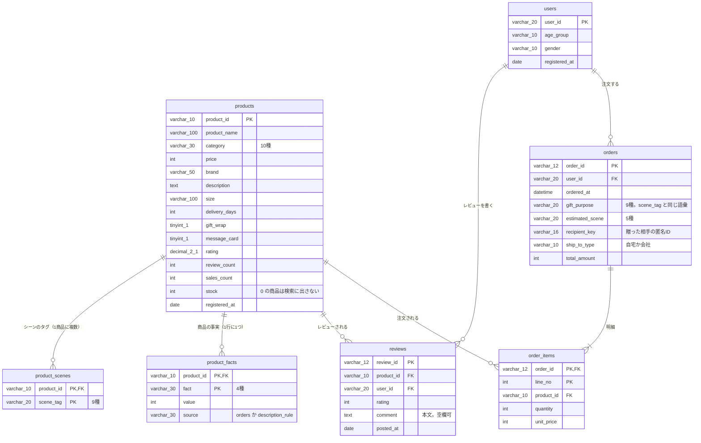
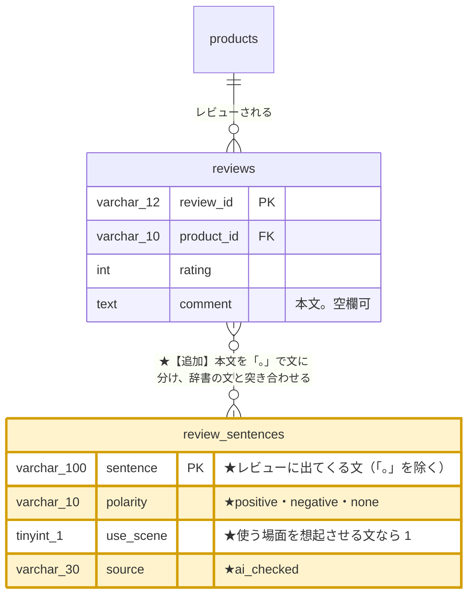
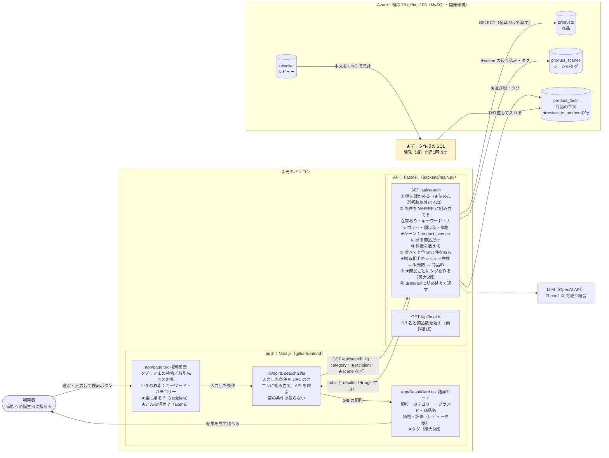
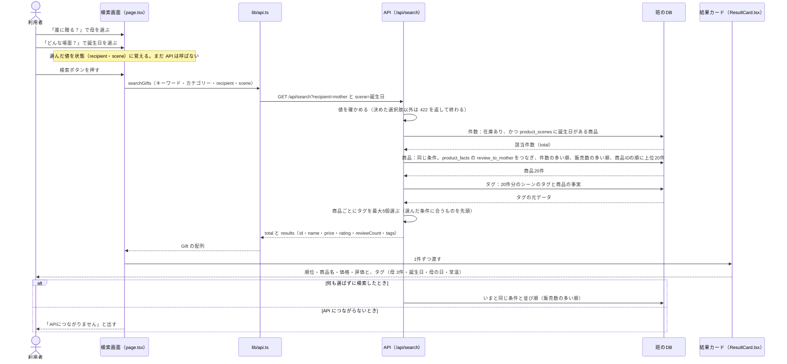
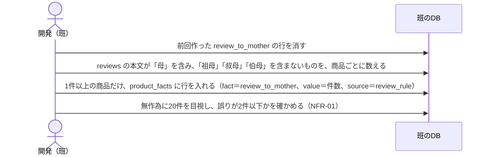

# 要件定義書

Tech0 Step3-1　Giftia ケース

Giftia「バースデーギフト改善」施策　― 何を、なぜこの構成・このロジックで作るか

| 項目 | 内容 |
| --- | --- |
| クラス名 | クラス1 |
| チーム名 | 3班_みっかんべー |
| メンバー | あかぷ、みかん、べー |
| 初版作成日 | 2026-11-07（チーム版の初版・3週目） |
| 最終更新日 | 6週目まで更新する |
| 対応する要求定義書 | [クラス1_3班_みっかんべー_要求定義書](../要求定義書/クラス1_3班_みっかんべー_要求定義書.md) |
| 班のリポジトリ | <https://github.com/TanobeYuya/Step3-1_giftia-mikkanbe>（public） |

- 元にしたもの: 3人の要件定義書（[べー](要件定義書_べー.md)、あかぷ追記版、みかん）と、[2026-11-07 定例MTG の議事録](../mtg/2026-11-07_定例MTG.md)。構成とデータ設計はべーの版、Phase2 以降のデータの案はあかぷ・みかんの版から取った。Phase2 の見直しは [2026-11-14 定例MTG の議事録](../mtg/2026-11-14_定例MTG.md)
- 記号: `【未記入】` はまだ決めていない欄。`【要確認】` はチームで確かめたい点がある欄。`（現状）` はいまのコードの状態で、施策で足す・変える前の起点
- 生成AIの利用: 各章の冒頭に書く（課題②の注意事項）

## この書類の位置づけ

要求定義書で決めた要求を、何を・どう作るかに落とす書類（IPA「ユーザのための要件定義ガイド」でいうシステム化要求定義）。3週目に初版を書き、実装しながら6週目まで更新する。目標は「動くモックで、なぜこの構成・このロジックかを説明できる」こと。6週目の発表の「②要件定義書パート」の骨格になる。

## 更新履歴

| 日付 | 更新した章 | 更新内容 | 更新者 |
| --- | --- | --- | --- |
| 2026-11-06〜07 | 全体 | 3人がそれぞれ要件定義書を書いた（べー：案A を前提、あかぷ：新案1 を前提、みかん：案B を前提） | あかぷ、みかん、べー |
| 2026-11-07 | 全体 | MTG の合意（検索画面のプルダウンで、贈る相手とシーンから絞り込む）を前提に、1つにまとめた | べー |
| 2026-11-10 | 2・3・4・5・6・7・9・付録A | Phase2 の範囲（日常の使う場面、贈る相手を父・友人・両親・同僚へ広げる）と、データの持ち方・作り方を決めた（#35） | べー |
| 2026-11-14 | 全体 | MTG の合意で Phase2 を見直した。贈る相手の拡大と日常の使う場面（FR-07）は Phase3 へ移した。Phase2 は ① レビューのモーダル（FR-06 を書き直す）→ ② 生成AIとの対話（FR-08）→ ③ ベクトル検索（FR-09）の順にする。データは文の辞書（DR-04）を足す。検索の応答時間（NFR-03）と、アンチパターンの確認結果（8章・付録A）を足した | べー |
| 2026-11-15 | 付録A | あかぷさんの MTG 前の案（比較表）から、議事録と食い違わない点（未記入の対応2つ、レビューに母の発言がないリスク）を取り込んだ。議事録と食い違う点は取り込んでいない | べー |
|  | 1・2・4・6・9・10 | 4週目：範囲と Phase1、画面・API、候補の取り方と並び順、制約、実装できるかの判断。仮確定 |  |
|  | 7・8 | 5週目：技術選定理由と構成、非機能要件。確定 |  |
|  | 全体 | 6週目の前：実装とのずれを確認（付録B） |  |

## チームで決めること（このチーム版で残った論点）

- 生成AIの利用: -with。3人の版と MTG の議事録から未決の点を抜き出した

| # | 決めること | このチーム版での仮の置き方 | 該当 |
| --- | --- | --- | --- |
| 1 | プルダウンの選択肢の分け方（贈る相手・シーンに何を並べるか） | 贈る相手は「指定なし」「母（義母を含む）」。シーンは product_scenes の9種類。MTG で「分け方はみかんの感覚を生かしたい」という意見があった | FR-01・FR-02 |
| 2 | 贈る相手を選んだとき、絞り込むか、並び順だけ変えるか | 並び順だけ変える（絞り込まない）。母・義母のレビューがある商品は 312件（全体の約3.9%）で、シーンと掛け合わせると結果が少なくなりすぎるため | FR-03・6.1 |
| 3 | 結果カードのタグに件数を出すか（例：［母 3件］か［母］か） | 未決 | FR-04・6.3 |
| 4 | プルダウンに気づいてもらう見せ方 | 選択欄の近くに「誰に贈る？」「どんな場面？」の見出しを出す。MTG で「今の画面では絞り込めることに気づきにくい」という指摘があった | FR-05 |
| 5 | 担当の分け方（機能・データ・画面など） | 未決 | — |
| 6 | 結果カードのタグ表示（FR-04）を Phase1 に含めるか | 含める（優先度：高）。MTG で合意したのはプルダウンでの絞り込みまでで、タグ表示は MTG のあとに べー案A から足した。足した理由：カードがなぜこの順に出たかの説明になる（選んだ条件に合っていることをタグで示し、条件の合い方が同じなら売れている順に並ぶ）。PR レビューで、あかぷ・みかんの合意を得る | FR-04・6.3 |
| 7 | Phase2 の範囲とデータの持ち方 | 見直した（2026-11-14 MTG）。2026-11-10（#35）に決めた範囲（日常の使う場面 FR-07、贈る相手の拡大 FR-01）は Phase3 へ移す。Phase2 は ① レビューのモーダル（FR-06）→ ② 生成AIとの対話（FR-08）→ ③ ベクトル検索（FR-09）の順。前の段で解決できれば次の段には進まない | 2・FR-01・FR-06〜FR-09・5章 |
| 8 | レビューのセンチメントと、使う場面の文の持ち方 | 文の辞書（review_sentences）を新しい表として足す（DR-04、5.3）。表を足すのは、レビュー1件ごとではなく、文の種類ごとに人が確かめるため。辞書の文の種類の数は【要確認】（SQL で数えてから決める） | FR-06・DR-04・NFR-04 |
| 9 | 検索の応答時間の目標 | 1秒以内（手元から10回測った中央値）。DB への接続を使い回して直す（NFR-03） | NFR-03 |

## 1. システム化の範囲

- 生成AIの利用: -with。Exhibit 5 の必須処理をいまのコードに当てはめ、チーム版の案を表にした

| 要求ID | 今回システムで実現するか | 理由 |
| --- | --- | --- |
| BR-01 手がかりを思い出せる | 一部を実現する | Phase1：検索画面の選択肢（贈る相手・シーン）を見ることで、思い出すきっかけを作る。Phase2：結果カードを押すとモーダルを開き、母に贈った人のレビューを、使う場面の文をハイライトして見せる（FR-06）。日常の使う場面（毎日の朝食など）の選択肢は Phase3 |
| BR-02 手がかりを条件にして絞り、選べる | 実現する | 選んだ相手・シーンで候補を絞り込み・並べ替え、結果カードのタグで合った条件を示す |
| BR-03 購入率 2.3% → 3.0% | システムでは実現しない（測る対象） | 購入率は、施策の結果として測る指標。Phase1 はモックで、本番の購入率は測れない（本番公開は対象外・Exhibit 5）。測り方は要求定義書 6章 |
| BR-04 工数の範囲で付け続ける | 実現する | 贈る相手は、レビュー本文から SQL のルールで付ける。商品部の手作業は要らない |

Exhibit 5 の必須処理と、いまのコードの対応

| 必須処理 | いまのコード（現状） | 施策で変えるか |
| --- | --- | --- |
| 入力を受ける | 画面の検索フォーム（`app/page.tsx`）→ `GET /api/search` のクエリ（q・category・indiv_wrap・price_min・price_max・limit） | 変える：「贈る相手」と「シーン」の選択欄（プルダウン）を足す（FR-01・FR-02） |
| 商品DBから複数の候補を取得 | `products` に WHERE で条件を足して取得（`backend/main.py`） | 変える：シーンを選んだら product_scenes で絞る（FR-03） |
| チームが設計したロジックで順位付け | `ORDER BY sales_count DESC, product_id`（販売数の多い順）。チーム独自のロジックはまだない | 変える：選んだ相手に贈ったレビューの件数が多い順にし、同じなら販売数の多い順（FR-03。6.2） |
| 結果を返す | JSON を返し、結果カード（`app/ResultCard.tsx`）で表示 | 変える：商品ごとにタグ（最大5個）を返し、結果カードに表示する（FR-04） |

## 2. 1〜3年後の姿と Phase1

- 生成AIの利用: -with。MTG の合意と3人の Phase2 以降の案をもとに表を作成

| 項目 | 内容 |
| --- | --- |
| 1〜3年後の姿 | どの相手・どのシーンでも、贈り手が自分の持つ手がかりを Giftia の中で思い出し、相手が使いそうな品を選べる。選択肢・タグ・同じ相手に贈った人の声・問いかけを組み合わせる。使う場面のデータは、レビューや購入後の声から自動で増えていく |
| Phase1 でやること | 検索画面に「贈る相手」と「シーン」のプルダウンを足す。シーンで絞り、選んだ相手に贈られてきた商品を上に並べる。結果カードに、合った条件が分かるタグ（最大5個）を出す。贈る相手は「母（義母を含む）」から始める（312商品） |
| Phase1 でやらないことと理由 | 日常の使う場面（「家で使う」「普段使い」など）の選択肢：データがなく、付け方と工数が未決（5.4）。同じ相手に贈った人のレビュー表示（べー案C）：よい面・気になる面の判定に生成AIが要り、工数が重い。商品ごとの問いかけ（あかぷ新案1）：回答と商品を結ぶデータ、回答の保存が要る。ベクトル検索・自由記述（案3）：改修の範囲が最も大きい。決済・実際の配送・本番公開・8,000商品すべてへのデータ付与は、開発条件で対象外（Exhibit 5） |
| Phase1 で検証すること（要求定義書 6章との対応） | 選択肢を見て、贈る相手についての手がかりを思い出せるか。絞った候補から、選んだ理由を説明できるか（6.4 のテストケースと、チーム内・身近な人での試用で確かめる） |
| Phase2 以降 | Phase2（2026-11-15 着手。2026-11-14 MTG で見直した）：思い出し型の課題を深掘りする。軽いものから順に3段で試し、前の段で解決できれば次の段には進まない（要求定義書 5.4）。<br>① レビューのモーダル（FR-06）：結果カードを押すと、商品名・価格・説明文と、レビューの一覧を出す。母に贈ったレビューを先頭にし、使う場面の文をハイライトする。センチメントで色を変える。<br>② 生成AIとの対話（FR-08）：AI とのやり取りで、母との場面を思い出してもらう。<br>③ ベクトル検索（FR-09）：思い出した言葉で、意味が近い商品を探す。<br>あわせて、検索の応答を1秒以内にする（NFR-03）。<br>Phase3：日常の使う場面の選択肢（FR-07。2026-11-10 に Phase2 として決めたものを移した）、贈る相手を父・友人・両親・同僚へ広げる（FR-01。同じく移した）、品物の雰囲気（シンプル・個性的）の選択肢（みかんの案。5.2）、商品ごとの問いかけ（あかぷ新案1）、購入後アンケートで使う場面を集める |

## 3. 要求→要件マッピング

- 生成AIの利用: -with。チーム版の案をもとに要件に分けた

| 要求ID | 要求 | 要件ID | 要件（何を作るか） | 確認方法 |
| --- | --- | --- | --- | --- |
| BR-01・BR-02 | 手がかりを思い出せる／手がかりを条件にして絞り、選べる | FR-01 | 検索画面で「贈る相手」をプルダウンから1つ選べる（未選択も可） | 画面で選び、API のクエリに recipient が付くことを確かめる |
| BR-01・BR-02 | 同上 | FR-02 | 検索画面で「シーン」をプルダウンから1つ選べる（未選択も可） | 画面で選び、API のクエリに scene が付くことを確かめる |
| BR-02 | 手がかりを条件にして絞り、選べる | FR-03 | シーンを選ぶと、そのシーンのタグを持つ商品に絞る。贈る相手を選ぶと、その相手に贈ったレビューの件数が多い商品から順に並ぶ | 6.4 のテストケース |
| BR-01・BR-02 | 同上 | FR-04 | 結果カードに、贈る相手・シーン・商品の性質のタグを、合わせて最大5個出す。選んだ条件に合うタグを先頭にする。「おすすめ」とは書かない | 6.4 のテストケースで、タグの数と並びを目で確かめる |
| BR-01 | 手がかりを思い出せる | FR-05 | プルダウンに気づけるように、選択欄の近くに「誰に贈る？」「どんな場面？」の見出しを出す | 試用で、説明なしにプルダウンを使えたかを記録する |
| BR-01・BR-04 | 手がかりを思い出せる／工数の範囲で付け続ける | DR-01 | 商品ごとに、贈った相手ごとのレビュー件数を product_facts に持つ | SQL で件数を確かめる（母・義母は 312商品の見込み） |
| BR-04 | 工数の範囲で付け続ける | DR-02 | DR-01 は SQL のルールで作り、新しいレビューが増えたら同じ SQL を流し直すだけで更新できる | SQL を2回流して、結果が同じになること |
| BR-01 | 手がかりを思い出せる | NFR-01 | 贈る相手の付け方の精度：無作為に20件見て、誤りが2件以下。Phase3 で足す相手（父・友人・両親・同僚）も、相手ごとに同じ基準で確かめる | ORDER BY RAND() で20件を目視 |
| BR-01・BR-02 | 手がかりを思い出せる／手がかりを条件にして絞り、選べる | FR-06 | 結果カードを押すとモーダルを開き、商品名・価格・説明文と、レビューの一覧を出す。母に贈ったレビューを先頭にし、使う場面の文をハイライトする。センチメントで色を変える（Phase2 ①） | 6.4 の Phase2 のテストケース。試用（要求定義書 6.1） |
| BR-01・BR-04 | 手がかりを思い出せる／工数の範囲で付け続ける | DR-04 | レビューの文ごとに、よい面か気になる面か、使う場面の文かを、文の辞書（review_sentences）に持つ（Phase2 ①） | SQL で辞書の件数と、どの文にも当たらないレビューの件数を確かめる |
| BR-01 | 手がかりを思い出せる | NFR-04 | 文の辞書の精度：レビューを無作為に20件見て、センチメントの4分類とハイライトの誤りが2件以下（Phase2 ①） | ORDER BY RAND() で20件を目視 |
| BR-02 | 手がかりを条件にして絞り、選べる | NFR-03 | 検索の応答時間：`/api/search` が1秒以内（手元から10回測った中央値） | 直す前と後に10回ずつ測り、記録する |
| BR-01 | 手がかりを思い出せる | FR-08 | 生成AIとの対話で、母との場面を思い出してもらう（Phase2 ②。①で解決できなければ着手） | ①の試用のあとに決める |
| BR-01・BR-02 | 手がかりを思い出せる／手がかりを条件にして絞り、選べる | FR-09 | 思い出した言葉で、意味が近い商品を探す（Phase2 ③。②で解決できなければ着手） | ②の試用のあとに決める |
| BR-01・BR-02 | 手がかりを思い出せる／手がかりを条件にして絞り、選べる | FR-07 | 検索画面で「日常の使う場面」をプルダウンから1つ選べる（未選択も可）。選ぶと、その場面のデータを持つ商品に絞る（Phase3。2026-11-14 に Phase2 から移した） | Phase3 で決める |
| BR-01・BR-04 | 手がかりを思い出せる／工数の範囲で付け続ける | DR-03 | 商品ごとに、日常の使う場面を product_facts に持つ（Phase3。売れ筋上位100商品から） | SQL で件数を確かめる |
| BR-01 | 手がかりを思い出せる | NFR-02 | 日常の使う場面の付け方の精度：無作為に20件見て、誤りが2件以下（Phase3） | ORDER BY RAND() で20件を目視 |
| BR-03 | 購入率 2.3% → 3.0% | （なし） | システムの要件ではなく、施策の結果として測る指標（1章） | 要求定義書 6章 |

## 4. 機能要件

- 生成AIの利用: -with。4.2・4.3 の（現状）の行は、いまのコードから書き出した。4.3 の応答の例は説明用に作った。ほかはチーム版の案をもとに作成

### 4.1 機能一覧

| ID | 機能名 | 概要 | 対応する要求ID | 優先度 |
| --- | --- | --- | --- | --- |
| FR-01 | 贈る相手の選択 | 検索画面に「贈る相手」のプルダウンを足す。Phase1 の選択肢は「指定なし」「母（義母を含む）」。Phase3 で「父（義父を含む）」「友人」「両親（義理の両親）」「同僚」を足す（件数と定義は 5.2。2026-11-14 に Phase2 から移した） | BR-01・BR-02 | 高 |
| FR-02 | シーンの選択 | 検索画面に「シーン」のプルダウンを足す。選択肢は product_scenes の9種類（誕生日・送別・お礼・母の日・お歳暮・お中元・結婚祝い・父の日・出産祝い）【要確認】 | BR-01・BR-02 | 高 |
| FR-03 | 選んだ条件での絞り込みと並び順 | シーンで絞り、贈る相手に贈ったレビューの件数が多い順に並べる。どちらも選ばないときは、いまと同じ販売数の多い順 | BR-02 | 高 |
| FR-04 | 結果カードのタグ表示 | 系統（贈る相手・シーン・商品の性質）ごとに上位2〜3個、合わせて最大5個のタグを出す。選んだ条件に合うタグを先頭にする。カードがなぜこの順に出たかの説明になる。MTG のあとに足した（PR レビューで合意を得る。「チームで決めること」の6） | BR-01・BR-02 | 高 |
| FR-05 | プルダウンに気づける見せ方 | 選択欄の近くに「誰に贈る？」「どんな場面？」の見出しを出し、絞り込めることが分かるようにする | BR-01 | 高 |
| FR-06 | レビューのモーダル（同じ相手に贈った人のレビュー表示） | 結果カードを押すとモーダルを開く（べー案C を 2026-11-14 に見直した）。<br>① 出すもの：商品名・価格・説明文（description）と、レビューの一覧。説明文はどの場合も出す。<br>② 一覧の順番：母に贈ったレビューを先頭にし、「母に贈った人」の印を付ける。本文のないレビューは出さない。よい面・気になる面の欄には分けない（1商品あたりのレビューが少ないため）。<br>③ レビュー1件ごとのカード：評価点と、原文のままの本文。色はセンチメントで変える（ポジティブは薄い青、ネガティブは薄い赤、ニュートラルとポジネガ混在は薄いグレー）。<br>④ 使う場面を想起させる文（例：「毎日使ってくれているようです」）はハイライトする。<br>⑤ レビューが0件なら「まだレビューがありません。」と出す。<br>センチメントとハイライトは文の辞書（DR-04）から決める。画面から LLM は呼ばない | BR-01・BR-02 | 高（Phase2 ①） |
| FR-07 | 日常の使う場面の選択 | 検索画面に「日常の使う場面」のプルダウンを足す。選択肢は「指定なし」「家で使う」「職場で渡しやすい」「普段使い」「特別な日向け」（みかんの案から、使う場面の4つを取った。「シンプル」「個性的」は Phase3 の候補。理由は 5.2【要確認】）。選ぶと、その場面のデータを持つ商品に絞る（データは 5.2〜5.4） | BR-01・BR-02 | 低（Phase3。2026-11-14 に Phase2 から移した） |
| FR-08 | 生成AIとの対話 | AI とのやり取りを通じて、母との場面を思い出してもらう（あかぷさんの案）。①（FR-06）の試用で解決できないと分かったら着手する。画面・やり取りの形は、着手するときに決める【未記入】。守ること：API キーはバックエンドだけに置く。入力は保存せず、送る前に画面で同意をとる。呼ぶ回数・長さに上限を設ける（8章） | BR-01 | 中（Phase2 ②。条件付き） |
| FR-09 | ベクトル検索 | 思い出した言葉で、説明文とレビュー本文の意味が近い商品を探す（べー案B）。同じ言葉には同じ結果を返す。②（FR-08）で解決できないと分かったら着手する。商品側のベクトルは事前に作って保存し、検索のたびに作るのは検索語の分だけにする | BR-01・BR-02 | 低（Phase2 ③。条件付き） |

### 4.2 画面一覧

| 画面名 | パス | 入力するもの | 表示するもの | 対応FR |
| --- | --- | --- | --- | --- |
| 検索画面（現状） | `/` | タブが2つある。「いまの検索」：キーワード、カテゴリー（コスメ・食品・生活雑貨）。「取引先へのお礼」：個包装、価格帯（3,000〜5,000円・5,000〜10,000円） | 検索結果のカード（順位・カテゴリー・ブランド・商品名・価格・評価・レビュー件数）。API につながらないときは「APIにつながりません」 | （現状） |
| 検索画面（チーム版） | `/` | 「いまの検索」タブに、贈る相手（プルダウン）とシーン（プルダウン）を足す。見出しは「誰に贈る？」「どんな場面？」。「取引先へのお礼」タブは変えない | 現状のカードに、タグを最大5個足す（例：「母」「誕生日」「母の日」「常温」） | FR-01〜FR-05 |
| 検索画面（Phase2 ①） | `/` | Phase1 と同じ。結果カードを押す | 押した商品のモーダル（FR-06）。商品名・価格・説明文と、レビューのカードの一覧。閉じるボタンと、モーダルの外を押すと閉じる | FR-06 |
| 検索画面（Phase3） | `/` | 贈る相手のプルダウンに「父（義父を含む）」「友人」「両親（義理の両親）」「同僚」を足す。「日常の使う場面」のプルダウンを足す（選択肢は FR-07） | Phase1 と同じカード | FR-01・FR-07 |

`/about` は Next.js の初期画面のままで、Giftia の画面ではない（現状）。

### 4.3 API一覧

| エンドポイント | メソッド | 受け取るもの | 返すもの | 対応FR |
| --- | --- | --- | --- | --- |
| `/api/search`（現状） | GET | q（空白区切り。すべてを含む商品）、category、indiv_wrap（説明文に「個包装」）、price_min、price_max、limit（1〜100、既定20） | 該当件数（total）と商品の配列（results：id・category・brand・name・price・rating・reviewCount）。在庫0の商品は出さない。販売数の多い順 | （現状） |
| `/api/health`（現状） | GET | なし | 接続中の DB 名と商品件数（動作確認用） | （現状） |
| `/api/search`（チーム版） | GET | 現状の引数に、recipient（贈る相手。"" か mother）と scene（シーンのタグ。"" か product_scenes の9種類のどれか）を足す。決めた値以外は 422（入力エラー）を返す | 現状の項目に、商品ごとの tags（系統・名前・件数の配列。最大5個）を足す。並び順は 6.2 | FR-01〜FR-04 |
| `/api/products/{product_id}`（Phase2 ①） | GET | product_id（G＋4桁。形が違えば 422、商品がなければ 404） | 商品名・価格・説明文と、レビューの配列（評価点・本文・センチメント・母に贈ったか・ハイライトする文）。本文のないレビューは返さない。並び順は FR-06。モーダルを開いたときに1回だけ呼ぶ（検索のたびに全カードの分を取らない） | FR-06 |
| `/api/search`（Phase3） | GET | recipient の値に father・friend・parents・coworker を足す。use_scene（日常の使う場面。"" か use_home・use_work・use_daily・use_special）を足す。決めた値以外は 422 を返す | Phase1 と同じ項目。並び順は 6.2 | FR-01・FR-07 |

チーム版の `/api/search` の応答の例（recipient=mother、scene=誕生日。値は説明用で、実際の商品とは限らない）

```json
{
  "total": 1234,
  "results": [
    {
      "id": "G2175",
      "category": "家電",
      "brand": "（ブランド名）",
      "name": "（商品名）",
      "price": 5400,
      "rating": 4.5,
      "reviewCount": 12,
      "tags": [
        { "kind": "recipient", "name": "母", "count": 3 },
        { "kind": "scene", "name": "誕生日" },
        { "kind": "scene", "name": "母の日" },
        { "kind": "fact", "name": "常温" }
      ]
    }
  ]
}
```

## 5. データ設計

- 生成AIの利用: -with。5.1 のER図は、班のDBを SQL で調べたデータ定義（仮）から描いた。5.2〜5.4 は、班のDBを調べた結果（べーの要求定義書 5章の調査メモ）と、あかぷ・みかんの版の Phase2 の案をもとに作成

### 5.1 ER図（配布の基本ER図からの拡張）

配布の「データ定義.md」は見つかっていない（TA に確認中）。代わりに、班のDB（giftia_t103）を SQL で調べたデータ定義（仮）に合わせて描いた。テーブル・列・型・外部キーは、SQL の結果で確かめたもの。

#### 変更前（いまの DB）



#### 変更後（Phase1）

検索画面に「誰に贈る？」「どんな場面？」のプルダウンを足す機能（FR-01〜04）のための変更。データを足すのは「誰に贈る？」の分だけで、「どんな場面？」はいまの product_scenes をそのまま使う。

| 機能 | 使うデータ | DB の変更 |
| --- | --- | --- |
| FR-01「誰に贈る？」で母を選ぶと、FR-03 母に贈られたレビューが多い順に並ぶ | product_facts の review_to_mother（件数） | ★追加：行を足す（312商品） |
| FR-02「どんな場面？」で選んだシーンの商品に絞る | product_scenes の scene_tag（9種） | なし（いまのデータを使う） |
| FR-04 結果カードにタグを出す | product_facts（review_to_mother と既存4種）・product_scenes | ★追加した行も使う |

変更前の図に、手を加えた部分だけを足した。テーブルと列は増やさない。黄色の product_facts と、★【追加】と書いた部分が変更点。

- product_facts に、fact ＝ review_to_mother の行を足す（312商品の見込み）。value は母・義母のレビュー件数、source は review_rule
- その行は、reviews の本文から SQL で集計して作る（点線の関係。外部キーではなく、データの作り方を示す）

```mermaid
erDiagram
  products ||--o{ product_scenes : "シーンのタグ（1商品に複数）"
  products ||--o{ product_facts : "商品の事実（1行に1つ）"
  products ||--o{ reviews : "レビューされる"
  products ||--o{ order_items : "注文される"
  users ||--o{ reviews : "レビューを書く"
  users ||--o{ orders : "注文する"
  orders ||--|{ order_items : "明細"
  reviews }o..o{ product_facts : "★【追加】本文を SQL で集計して行を作る"
  products {
    varchar_10 product_id PK
    varchar_100 product_name
    varchar_30 category "10種"
    int price
    varchar_50 brand
    text description
    varchar_100 size
    int delivery_days
    tinyint_1 gift_wrap
    tinyint_1 message_card
    decimal_2_1 rating
    int review_count
    int sales_count
    int stock "0 の商品は検索に出さない"
    date registered_at
  }
  product_scenes {
    varchar_10 product_id PK,FK
    varchar_20 scene_tag PK "9種"
  }
  product_facts {
    varchar_10 product_id PK,FK
    varchar_30 fact PK "4種 ★【追加】review_to_mother"
    int value "★【追加】母・義母のレビュー件数"
    varchar_30 source "orders か description_rule ★【追加】review_rule"
  }
  reviews {
    varchar_12 review_id PK
    varchar_10 product_id FK
    varchar_20 user_id FK
    int rating
    text comment "本文。空欄可"
    date posted_at
  }
  users {
    varchar_20 user_id PK
    varchar_10 age_group
    varchar_10 gender
    date registered_at
  }
  orders {
    varchar_12 order_id PK
    varchar_20 user_id FK
    datetime ordered_at
    varchar_20 gift_purpose "9種。scene_tag と同じ語彙"
    varchar_20 estimated_scene "5種"
    varchar_16 recipient_key "贈った相手の匿名ID"
    varchar_10 ship_to_type "自宅か会社"
    int total_amount
  }
  order_items {
    varchar_12 order_id PK,FK
    int line_no PK
    varchar_10 product_id FK
    int quantity
    int unit_price
  }
  style product_facts fill:#fff3cd,stroke:#d39e00,stroke-width:3px
```



Phase2 ①（2026-11-14 に見直した）では、文の辞書 review_sentences を新しい表として足す（DR-04）。reviews など既存の表は変えない。



Phase3 の候補（2026-11-10 に Phase2 として決めたもの）は、テーブルと列は増やさず、product_facts に、贈る相手（review_to_father など4種）と日常の使う場面（use_home など4種）の行を足す。source の値に 'ai_checked' が増える（5.2・5.3）。

### 5.2 追加するデータの定義

Phase1

| テーブル.カラム | 型 | 意味・定義 | 取りうる値 | 例 |
| --- | --- | --- | --- | --- |
| product_facts.fact ＝ 'review_to_mother'（足す fact の種類） | varchar(30) | その商品に、母・義母に贈ったと書かれたレビューがあること。レビュー本文に「母」を含み、「祖母」「叔母」「伯母」を含まないものを数える | 'review_to_mother'（Phase1）。父・友人などは件数を確かめてから足す | 'review_to_mother' |
| product_facts.value（上の行の値） | int | 母・義母に贈ったと書かれたレビューの件数 | 1以上の整数（0件の商品には行を作らない） | 3 |
| product_facts.source（上の行の値） | varchar(30) | 値の作り方 | 'review_rule'（レビュー本文からルールで作った） | 'review_rule' |

Phase2 ①（2026-11-14 に決めた）

文の辞書 review_sentences（新しい表）。レビューは決まった文の組み合わせでできている（[TC-09 の証拠](../evidence/261109_issue-31_5_tc09.md)）。そのため、レビュー1件ごとではなく、文の種類ごとに判定して人が確かめる。

| テーブル.カラム | 型 | 意味・定義 | 取りうる値 | 例 |
| --- | --- | --- | --- | --- |
| review_sentences.sentence（主キー） | varchar(100) | レビュー本文を「。」で分けた1文。末尾の「。」と前後の空白は除く | reviews.comment に出てくる文 | '毎日使ってくれているようです' |
| review_sentences.polarity | varchar(10) | その文が、商品のよい面を言っているか、気になる面を言っているか | 'positive'（よい面）・'negative'（気になる面）・'none'（どちらでもない。「母の誕生日に」など） | 'positive' |
| review_sentences.use_scene | tinyint(1) | 受け取った人が使う・食べる場面を想起させる文か | 1（想起させる）・0 | 1 |
| review_sentences.source | varchar(30) | 値の作り方 | 'ai_checked'（Claude Code が案を出し、べーが全件を確かめた） | 'ai_checked' |

レビュー1件のセンチメントとハイライトは、文の組み合わせから決める（表には持たない）。

| センチメント | 決め方（本文の文の polarity） | カードの色 |
| --- | --- | --- |
| ポジティブ | positive の文があり、negative の文がない | 薄い青 |
| ネガティブ | negative の文があり、positive の文がない | 薄い赤 |
| ポジネガ混在 | positive と negative の文が両方ある | 薄いグレー |
| ニュートラル | positive も negative の文もない。辞書にない文は none として扱う | 薄いグレー |

- ハイライトするのは、use_scene ＝ 1 の文。
- 母に贈ったレビューかは、表に持たず、review_to_mother と同じ条件（本文に「母」を含み、「祖母」「叔母」「伯母」を含まない）で決める。条件を2か所に書かないよう、仕様・設計書で1か所にまとめる。
- 辞書に入る文の種類の数は【要確認】（SQL で数えてから決める）。

Phase3 の候補（2026-11-10 に Phase2 として決めた。#35。2026-11-14 に Phase3 へ移した）

贈る相手は、母と同じ形で4種を足す。value・source の決まりは Phase1 と同じ（件数。0件の商品には行を作らない。source は 'review_rule'）。条件は、班のDBでレビューの1文目の型をすべて数えて決めた（2026-11-10、読み取りのみ。結果は [evidence](../evidence/261110_issue-35_recipient-patterns.md)）。下の表の件数はレビューの件数で、商品数ではない。

| fact | 選択肢の表示 | 数える条件（レビュー本文） | 当たるレビュー | 除いたもの |
| --- | --- | --- | --- | --- |
| 'review_to_father' | 父（義父を含む） | 「父」を含み、「祖父」「叔父」「伯父」を含まない | 265件（「義父の誕生日に」「父の誕生日に贈りました」「父の日に」など5つの型） | 「叔父へのお歳暮に」250件、「祖父の誕生日に」73件 |
| 'review_to_friend' | 友人 | 「友」を含む（「友人」と「友だち」の両方がある） | 1,966件（14の型。誕生日・結婚・出産・新居） | なし |
| 'review_to_parents' | 両親（義理の両親） | 「両親」を含む | 259件（「義理の両親へのお歳暮に」の1つの型だけ） | なし |
| 'review_to_coworker' | 同僚 | 「同僚」を含む | 131件（送別・産休の2つの型） | なし |

日常の使う場面は、product_facts に4種の fact を足す。当てはまる商品にだけ value＝1 の行を入れ、当てはまらない商品には行を作らない。

| fact | 選択肢の表示 | 意味・定義 | 例 |
| --- | --- | --- | --- |
| 'use_home' | 家で使う | 受け取った人が、自宅で使う・食べる品 | G0003 / use_home / 1 / 'ai_checked' |
| 'use_work' | 職場で渡しやすい | 職場で配る・渡すのに向く品（個包装で分けやすいなど） | — |
| 'use_daily' | 普段使い | 特別な日でなく、毎日の暮らしで使う品 | — |
| 'use_special' | 特別な日向け | お祝いの席や記念日に使う・開ける品 | — |

- source は 'ai_checked'（Claude Code が説明文とレビュー本文から案を出し、べーが全件を確認した）を足す。
- みかんの版の vibe_simple（シンプル）・vibe_unique（個性的）は、使う場面の4種とあわせては入れず、Phase3 の候補として残す【要確認】。理由は3つ。① 品物の雰囲気・相手の好みで、使う場面とは問いが違う。同じプルダウンに並べると、両方に当てはまる人が1つしか選べない。② 人によって判断が分かれ、20件の目視（NFR-02）で何を誤りとするかを決めにくい。③ 100商品に付ける種類が 1.5 倍になる。一方、Exhibit 4 は「個性的／無難」を検索に使えない情報に挙げており、顧客の困りごとに近い軸である。
- 選ばなかった案：あかぷの版の product_use_scenes（使う場面を「毎日の食卓で使う」のような文で持つ別テーブル）。理由は 5.3 に書いた。

参考（ケース資料 Exhibit 4 の「構造化されていない情報」。検索や絞り込みに使えない情報の一覧）: 職場で渡しやすい、好みが分からない相手にも選びやすい、個性的／無難、気を遣わせにくい、実用的、みんなで分けられる、常温で保存できる、個包装かどうか、日持ち（賞味期限）、香りの有無・強さ、荷物になりにくい

### 5.3 データをどこに持たせたか

| 項目 | 内容 |
| --- | --- |
| 選んだ持たせ方 | 商品側に持たせる。既存の product_facts に1行ずつ足す（縦持ち：事実の種類を列ではなく行で増やす形）。母・義母に触れたレビューがある商品だけ（312商品の見込み） |
| 選ばなかった案 | ① products に列（例：mother_review_count）を足す。② 新しい表（例：product_recipients）を作る。③ 会員・送り先の側に持たせる |
| 理由 | product_facts は、常温・個包装など「商品の事実」を1行ずつ持つ表で、同じ形で足せる。表の構造を変えずに、相手の種類を増やせる。作り方（source）の区別も既存のしくみでできる。①は相手が増えるたびに列が増え、空欄も多い。②は product_facts と役割が重なる。③は、レビューが商品について書かれているため、商品側に持たせるのが素直。べーとみかんの版で同じ判断だった |
| Phase2 ① の持たせ方 | 文の辞書 review_sentences を新しい表として足す（2026-11-14）。センチメントと、使う場面の文は、レビューの文ごとの性質で、商品の事実（product_facts）ではないため |
| Phase2 ① で選ばなかった案と理由 | ① reviews に列（sentiment など）を足す：配布された表を書き換えることになる。7,419件を1件ずつ確かめる必要があり、人の確認が追いつかない。② レビュー1件ごとの表（review_id ごとに判定）を作る：①と同じく、確かめる件数が多い。新しいレビューが増えるたびに判定し直す必要もある。辞書なら、知っている文だけでできたレビューは、判定し直さずに色とハイライトが決まる |
| Phase3 の持たせ方 | 贈る相手（4種）も日常の使う場面（4種）も、同じ product_facts に行を足す。2026-11-10 に Phase2 として決めた（#35） |
| Phase3 で選ばなかった案と理由 | 別テーブル product_use_scenes（あかぷの版）：使う場面を文で持つと、プルダウンで選んだ値と突き合わせられない。別テーブルに選択肢の値の列を足すと、product_facts と役割が重なる。product_facts なら、Phase1 の検索とタグの作りを、定数を足すだけで使い回せる |

### 5.4 データ供給計画

| データ | 誰が | どうやって | 何件に | 新商品のとき | 年間の工数 | 精度の確かめ方 |
| --- | --- | --- | --- | --- | --- | --- |
| review_to_mother（母・義母に贈ったレビューの件数）Phase1 | 開発（班） | reviews.comment に LIKE の条件をかけて、商品ごとに数える SQL を流す | 312商品の見込み（レビュー 425件） | レビューが付けば、同じ SQL を流し直すだけで付く。レビューがない新商品には付かない | 商品部：0人日（SQL を流すのは開発側。月1回で数分の見込み、未確認） | 無作為に20件を目視し、母・義母以外が混ざっていないかを数える。「叔母」の混入は条件で除いた |
| review_sentences（文の辞書）Phase2 ① | 開発（班） | 本文のあるレビューを SQL で「。」ごとに文に分け、文の種類と出てくる回数を CSV に出す。Claude Code が polarity と use_scene の案を付け、べーが全件を確かめてから SQL で入れる | 文の種類の数は【要確認】（本文のあるレビューは 7,419件） | 辞書にない文が出てきたら、その文だけ足す。辞書にない文は none として扱うので、足すまでの間も画面は動く | 新しい文の種類が出たときだけ。仮に月0.5人日【要確認】 | レビューを無作為に20件見て、センチメントの4分類とハイライトの誤りが2件以下（NFR-04） |
| review_to_father・friend・parents・coworker（贈る相手）Phase3 | 開発（班） | review_to_mother と同じ形の SQL を、相手ごとに1ファイル流す | 当たるレビューは、父 265件・友人 1,966件・両親 259件・同僚 131件（商品数は SQL を流して確かめる） | review_to_mother と同じ | review_to_mother と同じ | 相手ごとに、無作為に20件を目視する（NFR-01） |
| use_home など（日常の使う場面）Phase3 | 開発（班）。運用では商品部が確認する | 売れ筋上位100商品の説明文とレビュー本文を Workbench で CSV に出し、Claude Code が場面の案を付ける。べーが全件を確認してから SQL で入れる。使い方の文は文型がばらばらで、ルールだけでは抜けない（べーの調査）ため、ルールの SQL にしない | 売れ筋上位100商品から始める | 登録時に用途を選ぶ項目を入れる（運用に移すとき） | 仮に月1人日（年12人日）。商品部の月5人日の範囲内（みかんの版） | 入れた行から無作為に20件を目視し、誤りが2件以下（NFR-02） |

## 6. 候補の取り方と並び順（検索・絞り込み・ランキング）

- 生成AIの利用: -with。べーの版の並び順とテストケースを、MTG の合意に合わせて書き直した

### 6.1 方式と選んだ理由

| 項目 | 内容 |
| --- | --- |
| 方式 | 絞り込み（シーン）と、並び順を変えるルール（贈る相手）の組み合わせ。LLM は使わない |
| 選んだ理由 | 要求定義書 5.3 の案と同じ。選んだ条件と並び順の理由を、タグでそのまま説明できる（「母」のタグがあるから上にある）。データの大半が班のDBにあり、費用もかからない |
| 選ばなかった方式と理由 | 贈る相手での絞り込み：母・義母のレビューがある商品は 312件（全体の約3.9%）で、絞ると結果が少なくなりすぎる【要確認】。LLM で提案：出力が毎回変わり、なぜその順かを説明しにくい。費用もかかる |

### 6.2 候補の取り方と順位の付け方

| 項目 | 内容 |
| --- | --- |
| 入力（ユーザーから受け取るもの） | 現状の入力（キーワード・カテゴリー・個包装・価格）＋ 贈る相手（指定なし／母。Phase3 で父・友人・両親・同僚を足す）＋ シーン（指定なし／9種類）＋ 日常の使う場面（Phase3。指定なし／4種類） |
| 候補取得の条件 | 現状の条件に加え、シーンを選んだら product_scenes にそのタグがある商品だけにする。Phase3 では、日常の使う場面を選んだら、product_facts にその場面の行（use_home など）がある商品だけにする。贈る相手では絞らない |
| 順位付けのロジック | 贈る相手を選んだとき：① 選んだ相手に贈ったレビューの件数が多い順（Phase1 は母だけなので review_to_mother。Phase3 は選んだ相手の review_to_father などを使う。行がない商品は0件として後ろ）→ ② 販売数の多い順 → ③ 商品IDの順。選ばないとき：現状と同じ（販売数の多い順 → 商品ID）。日常の使う場面は絞り込みだけに使い、並び順は変えない |
| 使うデータ（テーブル.カラム） | products（現状の列）、product_scenes.scene_tag、product_facts（fact・value。review_to_mother と、タグに使う room_temp・indiv_wrap・shelf_life_days。Phase3 で review_to_father など4種と use_home など4種を足す） |

### 6.3 推薦理由

| 項目 | 内容 |
| --- | --- |
| 何を説明するか | カードがなぜこの順に出たか。選んだ条件（贈る相手・シーン）に合っていることをタグで示す。条件の合い方が同じなら、売れている順（販売数の多い順）に並ぶ。贈る相手を選んだときは、その相手に贈られたレビューの件数が多い順が先に来る（6.2） |
| 理由の作り方 | 推薦の文は作らず、タグで理由を示す（「おすすめ」とは書かない）。タグは系統ごとに上位2〜3個、合わせて最大5個。並べる順は、① 検索で選んだ相手・シーンに合うタグ → ② 贈る相手（件数の多い順）→ ③ シーン → ④ 商品の性質（常温・個包装・賞味期限） |
| 表示の例 | 母・誕生日で検索したときの結果カード：［母 3件］［誕生日］［母の日］［常温］。件数を出すかは未決 |

### 6.4 良し悪しの確かめ方（テストケース）

| No | 入力する状況 | 期待する結果（上位に来るべきもの・来てはいけないもの） | 実際の結果 | 判定 |
| --- | --- | --- | --- | --- |
| 1 | 贈る相手：母、ほかは指定なし | 上位は review_to_mother の件数が多い商品。1件目のカードの先頭タグが「母」 |  |  |
| 2 | 贈る相手：母、シーン：誕生日 | 全件が「誕生日」のタグを持つ。その中で母のレビューが多い順 |  |  |
| 3 | 贈る相手：母、シーン：母の日 | 全件が「母の日」のタグを持つ。上位に母のレビューがある商品 |  |  |
| 4 | 贈る相手：指定なし、シーン：指定なし | 現状と同じ順（販売数の多い順）。並びが変わっていない |  |  |
| 5 | 贈る相手：母、シーン：出産祝い | 結果は出産祝いのタグを持つ商品だけ。母のレビューがない商品ばかりでも、0件にならずに販売数の順で並ぶ |  |  |
| 6 | 贈る相手：母、キーワード：タオル | キーワードの条件を満たす商品だけ。その中で母のレビューが多い順 |  |  |
| 7 | 贈る相手：母、価格：3,000〜6,000円 | 価格の範囲外の商品が出ない。家族への誕生日の平均単価 5,400円（Exhibit 1 表2）の前後で候補が出る |  |  |
| 8 | 任意の検索 | どのカードもタグが5個以下。同じタグが重ならない。「おすすめ」の文字が出ない |  |  |
| 9 | 贈る相手：母 で上位20件のレビューを目視 | 上位の商品のレビューに、叔母・祖母・友人の母への言及だけの商品が入っていない |  |  |
| 10 | 説明なしで検索画面を見せる（試用） | プルダウンで絞り込めることに気づき、相手かシーンを選べる（FR-05）。試用の進め方と見ることは、要求定義書 6.1（1回目：Phase1 の画面で1〜2人） |  |  |

Phase2 ① のテストケース（2026-11-14 に書き直した。番号は仕様・設計書の TC と重ならないよう P2- を付ける）

| No | 入力する状況 | 期待する結果 | 実際の結果 | 判定 |
| --- | --- | --- | --- | --- |
| P2-1 | 母のレビューが2件以上ある商品のカードを押す | モーダルに商品名・価格・説明文が出る。母に贈ったレビューが先頭に並び、「母に贈った人」の印が付く。本文のないレビューは出ない |  |  |
| P2-2 | レビューが0件の商品のカードを押す | 「まだレビューがありません。」と説明文が出る。エラーにならない |  |  |
| P2-3 | ポジティブ・ネガティブ・ポジネガ混在・ニュートラルのレビューがある商品を、それぞれ開く | カードの色が、薄い青・薄い赤・薄いグレー・薄いグレーになる（5.2 の決め方） |  |  |
| P2-4 | 使う場面の文（use_scene ＝ 1）を含むレビューを開く | その文だけがハイライトされ、本文はほかの部分も含めて原文のまま出る |  |  |
| P2-5 | `/api/products/` に形の違う ID（例：`abc`、`G0001;DROP`）と、ない ID（例：`G9999`）を渡す | 形が違えば 422、ない ID は 404。どちらも DB の内容は出ない |  |  |
| P2-6 | 本文に `<script>alert(1)</script>` を含むレビューを表示する（テスト用のダミーデータで確かめる） | 文字としてそのまま出て、スクリプトは動かない |  |  |
| P2-7 | 文の辞書から、レビューを無作為に20件見る | センチメントの4分類とハイライトの誤りが2件以下（NFR-04） |  |  |
| P2-8 | `/api/search` を、贈る相手：母、シーン：誕生日で10回呼ぶ | 応答時間の中央値が1秒以内（NFR-03）。直す前と後の数字を記録する |  |  |
| P2-9 | Phase1 の 6.4 No.1〜8 を流し直す | Phase1 と同じ結果（Phase1 の動きが変わっていない） |  |  |
| P2-10 | 説明なしで画面を見せる（試用。2回目） | 要求定義書 6.1 の見る指標を記録する（実装の PR の条件にはしない） |  |  |

Phase3 のテストケース（2026-11-10 に Phase2 として書いたもの。番号は P3- に付け替えた）

| No | 入力する状況 | 期待する結果（上位に来るべきもの・来てはいけないもの） | 実際の結果 | 判定 |
| --- | --- | --- | --- | --- |
| P3-1 | 贈る相手：父・友人・両親・同僚のそれぞれ、ほかは指定なし | 上位は、選んだ相手の件数（review_to_father など）が多い商品。1件目のカードの先頭タグが、選んだ相手 |  |  |
| P3-2 | 贈る相手：父 で上位20件のレビューを目視 | 叔父・祖父への言及だけの商品が入っていない |  |  |
| P3-3 | 足した相手ごとに、判定したレビューを無作為に20件目視 | どの相手も、誤りが2件以下（NFR-01） |  |  |
| P3-4 | 日常の使う場面：家で使う・職場で渡しやすい・普段使い・特別な日向けのそれぞれ | 全件が、選んだ場面のデータを持つ |  |  |
| P3-5 | 日常の使う場面のデータから、無作為に20件目視 | 誤りが2件以下（NFR-02） |  |  |
| P3-6 | 日常の使う場面：家で使う、シーン：出産祝い | エラーにならない。結果が0件のときは0件と分かる表示になる |  |  |
| P3-7 | 日常の使う場面：指定なし、贈る相手：母 | Phase1 の 6.4 No.1 と同じ結果（Phase1 の動きが変わっていない） |  |  |

## 7. 技術選定理由と構成

- 生成AIの利用: -with。7.1 の構成図と 7.2 のシーケンス図は、いまのコード（page.tsx・lib/api.ts・ResultCard.tsx・main.py）とチーム版の案から描いた。選定理由は、開発条件で決まっている事実だけを書いた

| レイヤー | 技術 | 選定理由 | 比べた候補 |
| --- | --- | --- | --- |
| 画面（UI） | Next.js（手元のパソコンで動かす） | 開発条件で指定（Exhibit 5）。【未記入】自分たちの言葉での理由 | Streamlit など |
| API | FastAPI（手元のパソコンで動かす） | 開発条件で指定（Exhibit 5）。【未記入】 |  |
| データベース | Azure Database for MySQL（班のDB・開発環境） | 開発条件で「Exhibit 4 の現状データベース」と指定（Exhibit 5）。【未記入】 | SQLite など |
| LLM（使う場合） | 未定（講座で配られた ChatGPT の API か、オープンソースのモデル。Phase2 ② に着手するときに決める） | Phase1 では使わない。贈る相手は SQL のルールで付けられ、並び順の理由をタグで説明できるため。Phase2 ①（FR-06）でも、アプリからは呼ばない。文の辞書（DR-04）は、開発のときに Claude Code が案を出し、人が確認して DB に入れる（5.4）。表示のたびに呼ばないのは、費用・API キーの管理・毎回結果が変わる問題を避けるため（2026-11-14 MTG）。<br>Phase2 ②（FR-08）で初めてアプリから呼ぶ。使うモデル（講座で配られた ChatGPT の API か、オープンソースのモデルか）は、着手するときに決める【未記入】 | ルール・スコアのみ など |
| 公開（発展課題） | Azure（任意） | 【未記入】 | 今回は手元で動かす |

### 7.1 構成図

画面の部品・API の処理・DB のテーブルと、そのつながり。★ はチーム版で足す・変えるもの。黄色の枠は Phase1 で新しく作るもの。LLM は Phase2 ②（FR-08）で使う場合だけなので点線で示す。Phase2 ① で足すもの（`/api/products/{product_id}`、モーダル、review_sentences）は、この図には描いていない。仕様・設計書の Phase2 の章で描く。



### 7.2 利用者の操作と、画面・API・DB の動き

「誰に贈る？」で母、「どんな場面？」で誕生日を選んで検索したとき。SQL の分け方（件数・商品・タグの3回）は案で、実装で変えてよい。



データ作成の流れ（検索とは別に、開発が月1回流す）



## 8. 非機能要件

- 生成AIの利用: -with。セキュリティの行は、いまのコードの実装とテンプレートの必須事項から作成。ほかは開発条件の事実だけ

| 大項目 | 今回の要件 | 目標値・方針 | 対象外にした場合の理由 |
| --- | --- | --- | --- |
| 可用性 | 【要確認】対象外とするか |  | 本番公開は対象外（Exhibit 5）。手元で動かすモックのため |
| 性能・拡張性 | 検索の応答時間（NFR-03）。応答が1秒以内なら、操作する人の考えが途切れないとされる。データは8,000商品と小さく、無理のない目標 | `/api/search` が1秒以内（手元のパソコンから班の DB へ、10回測った中央値）。<br>遅い原因の見込み：検索1回で DB に4回問い合わせ、そのたびに Azure へ新しく接続し、暗号化（SSL）の手続きをやり直している（`database.py` の `fetch_all`。2026-11-14 にコードを読んで分かった。時間はまだ測っていない）。<br>直し方：① 検索1回の中で接続を1つだけ使う → ② 接続プール（作った接続をためておき、次の検索でも使う）を使う。直す前と後に測る |  |
| 運用・保守性 | 【未記入】 | 【未記入】 |  |
| 移行性（追加データの投入、本番のDBへの反映） | 【未記入】 | 【未記入】 |  |
| セキュリティ | DB の接続情報と API キーは `.env` に置き、GitHub にコミットしない（`.gitignore` で除外）。画面側（Next.js）に置かない。SQL の値はプレースホルダー（%s）で渡し、文字列に直接つなげない（SQL インジェクション対策）。プルダウンの値も、決めた選択肢以外は受け付けない。ブラウザから API を呼べるのは、`.env` の CORS_ORIGINS に書いた画面の URL だけ（CORS。認証の代わりにはならない）。<br>Phase2 で足すこと（2026-11-14 のアンチパターンの確認から。付録A）：① レビュー本文は React の自動エスケープに任せて出し、HTML として埋め込まない（`dangerouslySetInnerHTML` を使わない。XSS 対策）。ハイライトは文字列を分けて `<mark>` で囲む。② `/api/products/{product_id}` の ID は形（G＋4桁）を確かめる。③ キーワードの長さに上限を設ける（極端に長い入力で重い SQL にならないように）。④ DB の証明書のパス（DB_SSL_CA）を設定し、相手が本物の Azure かを確かめる。<br>Phase2 ②（FR-08）で守ること：API キーはバックエンドの `.env` だけに置き、画面側（`NEXT_PUBLIC_`）に置かない。利用者の入力は保存せず、AI に送る前に画面で同意をとる。呼ぶ回数・長さに上限を設け、タイムアウトを決める。AI の出力は、画面に出す前に形を確かめる | 班の DB は開発環境で、本番ではない。データはダミーで、個人情報を持たない（Exhibit 4） |  |
| システム環境・エコロジー | 【要確認】対象外とするか |  | 【未記入】 |

## 9. 制約条件

- 生成AIの利用: -with。ケース資料の開発条件から転記

| 項目 | 内容 |
| --- | --- |
| 期間 | 2か月（要求・要件を固めて提案する。実装は一部でよい） |
| 人員 | 班のメンバー3人（あかぷ、みかん、べー） |
| 社内の工数 | 商品部：月5人日程度／編集チーム：月10人日程度 |
| 技術 | Next.js・FastAPI・現状データベース（班の Azure MySQL）・Azure |
| 期限 | 発表は 2026-11-24（火）。2026-11-14 時点で残り約10日。発表の準備と受け入れテストを除くと、実装に使えるのはさらに短い |
| 費用 | Phase1・Phase2 ① は、アプリから LLM を呼ばないため、追加の利用料はかからない。Phase2 ②（FR-08）で呼ぶ場合の上限は、着手するときに決める【未記入】 |
| 引き継ぎ先 | 開発部（外部の開発メンバーを含む）。要求定義書・要件定義書で引き継ぐ（Exhibit 5） |
| 対象外 | 決済、実際の配送、本番公開、8,000商品すべてへのデータ付与（Exhibit 5） |
| 制約から逆算して決めたこと | 残りの期間で作り直す余裕は少ないため、Phase1 は生成AIも表の追加も要らない範囲に絞った（MTG）。<br>Phase2 は、30人規模の試用をやめて3〜6人にし、開発と並行して進める。贈る相手の拡大はやめ、思い出し型の課題に絞る。軽いもの（工数1〜2日のレビュー表示）から順に作り、前の段で解決できれば次の段には進まない（2026-11-14 MTG） |

## 10. 実装できるかの判断

- 生成AIの利用: -with。チーム版の案と班のDBを調べた結果をもとに作成（4週目に見直す）

| 観点 | 判断 | 根拠 |
| --- | --- | --- |
| データは用意できるか | できる見込み | 母・義母への言及があるレビューは 425件・312商品（SQL で集計）。シーンのタグ（9種類）と商品の事実（常温など）は班のDBにある |
| 期間内に作れるか | できる見込み | 変えるのは /api/search の引数と並び順、検索画面のプルダウン2つと見出し、結果カードのタグ。表の構造は変えない。生成AIを使わない |
| 候補の取り方と並び順は具体的に書けているか | 書けている（仮） | 6.2 に、絞り込みの条件と順位の付け方（①相手のレビュー件数 → ②販売数 → ③商品ID）を書いた |
| データ供給は続くか | 続く見込み | SQL を流し直すだけで更新でき、商品部の手作業は要らない（5.4） |
| 1〜3年後の姿に対して、Phase1で何を検証するか | 選択肢を見て手がかりを思い出せるか。絞った候補から選べるか | 思い出せなければ、Phase2 ① で同じ相手に贈った人のレビュー表示を足す（2026-11-14 に、試用を待たずに Phase2 ① として作ると決めた） |
| Phase2 ① は期間内に作れるか | できる見込み | 工数の目安は1〜2日（MTG で生成AIに聞いた目安）。新しい API 1本、モーダル、文の辞書の表1つ。画面から LLM は呼ばない。文の辞書の作業量は、文の種類の数による【要確認】 |

## 付録A. 残課題とリスク

- 生成AIの利用: -with。1027 課題①のチーム投稿「弱いところ」と、3人の版・MTG の指摘から転記

| 内容 | 影響 | 対応（いつ・誰が） |
| --- | --- | --- |
| ヒアリングは各シーン1名で、顧客課題の確度は中程度 | 採用した課題が、そのシーンの多くの顧客に当てはまらない可能性 | 試用（要求定義書 6.1）で、思い出し型と安心型がどれくらいいるかも聞く。根拠がDさん1人であることは、発表で明示する（あかぷさんの案から取り込んだ） |
| 詰まりと購入率の関係は、シーン単位の傾向で、因果は未検証 | 施策で詰まりを解いても、購入率が上がらない可能性 | 試作では、詰まりが解けるか（理由を持って決められるか）までを確かめる。購入率への効果は、本番で1人ごとの購入率を見て確かめる（要求定義書 6.2。あかぷさんの案から取り込んだ） |
| 画面を見て、その場で思い出せるか（Dさんは数日後に思い出した） | プルダウンを見ても思い出せず、施策が効かない可能性 | 試用で確かめる（要求定義書 6章） |
| 選択肢に当てはまらない人がいる（みかんの指摘） | 選ばずにランキングへ戻り、施策に届かない | 試用で、選ばなかった人の理由を聞く。選択肢の分け方を見直す |
| 今の画面では、プルダウンで絞り込めることに気づきにくい（あかぷの指摘） | 使われず、到達率が下がる | FR-05 で見出しを出す。6.4 No.10 で確かめる |
| シーンの選択肢（product_scenes）はイベントで、日常の使う場面（毎日の朝食など）ではない | 「母が使う場面」を思い出すきっかけとして弱い可能性 | Phase2 ① で、使う場面の文をハイライトしたレビューを見せる（FR-06）。日常の使う場面の選択肢（FR-07）は Phase3 |
| 贈る相手は LIKE のルールで付けるため、誤りが混ざる（「叔母」が「母」に当たる誤りは見つけて除いた） | 母以外に贈った商品が上位に出る | 無作為20件の目視で確かめる（NFR-01・6.4 No.9） |
| タグが付くのは 312商品（全体の約3.9%）で、多くの商品はタグなしのまま | 到達率が低く、購入率への効果が小さい可能性 | Phase1 は効果の大きさではなく、思い出して選べるかを確かめる。広げ方は Phase3 |
| 日常の使う場面のデータは、売れ筋上位100商品にしか付かない | 使う場面とシーン・相手を組み合わせると、結果が0件か、ごく少なくなる | 6.4 P3-6 で0件のときの表示を確かめる。付ける範囲の広げ方は Phase3 |
| レビュー本文は決まった言い回しの組み合わせで、演習用に作られたデータの可能性がある | 本番のレビューでは、同じルールで相手を抜けない可能性 | 本番に移すときに、実データで抜け方を確かめる（移行時） |
| 文の辞書（DR-04）は、レビューが決まった文の組み合わせでできていることを前提にしている | 本番の自由な文章のレビューでは、辞書に当たらない文が多くなり、ほとんどがニュートラルになる | 本番に移すときに、文ごとの判定を LLM などに置き換えるかを決める（移行時） |
| 母に贈ったレビューは定型の文で、母の過去の発言は書かれていない。上位20商品の97件の全文に、「言っていた」「欲しがって」「前から」「話して」「言って」は0件（[TC-09 の97件](../evidence/261112_issue-31_8_tc09-top20-reviews.tsv) を 2026-11-15 に文字列で検索。あかぷさんの指摘） | レビューを見せても、母の発言を思い出すきっかけにはならない可能性 | 母の発言ではなく、使う場面の文（「毎日使ってくれているようです」など）をハイライトして、母の暮らしを思い出すきっかけにする（FR-06）。外れたら Phase2 ②（生成AIとの対話）に進む |
| 母のレビューがある商品のうち258商品は1件だけ（仕様・設計書 1.2）。モーダルで見せられる「母に贈った人の声」は少ない | 思い出すきっかけとして弱く、試用で外れる可能性 | 母以外のレビューも、使う場面の文をハイライトして続けて出す（FR-06）。外れたら Phase2 ② に進む |
| 試用は3〜6人で、役を演じてもらう | 仮説が証明されたとは言えない | 結果は「兆しを見た」とまで言う。本番の検証（要求定義書 6.2）で確かめる |
| 検索の応答が遅い（2026-11-14 MTG で、あかぷさん・みかんさんが指摘） | 試用やデモで待たされ、使う人の考えが途切れる | NFR-03。接続を使い回して直し、直す前と後に測る（6.4 P2-8） |
| アンチパターンの確認（2026-11-14、コードを読んで確認）で見つかった点：① 問い合わせのたびに DB へ接続し直している（高）。② 証明書のパスがないと、DB の相手が本物かを確かめない（中）。③ 検索中の表示がなく連打でき、古い応答が新しい結果を上書きするおそれがある（中）。④ キーワードの長さに上限がない（低） | 遅い、なりすましに弱い、表示が乱れる、重い SQL を流される | ①は NFR-03 で直す。②④は 8章のセキュリティに足した。③は Phase2 ① の画面の Issue で直す。確認の記録は [evidence](../evidence/261114_antipattern-check.md) |

## 付録B. 実装とのずれの確認

- 生成AIの利用: なし（未記入）

| 確認すること | 一致しているか | 直したこと |
| --- | --- | --- |
| ER図・データ定義（5章）と実際のテーブル |  |  |
| API一覧（4.3）と実際のエンドポイント |  |  |
| 候補の取り方と並び順（6章）と実際のコード |  |  |
| テストケース（6.4）の実際の結果 |  |  |
| 構成図（7.1）と実際に動かした構成（手元／Azure） |  |  |
