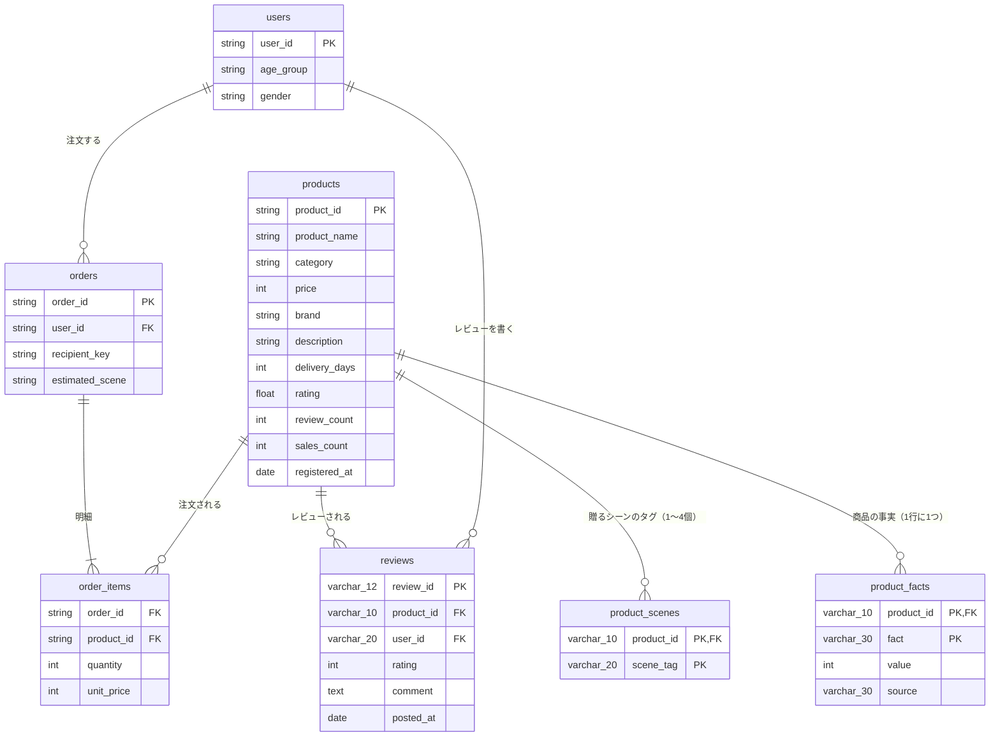
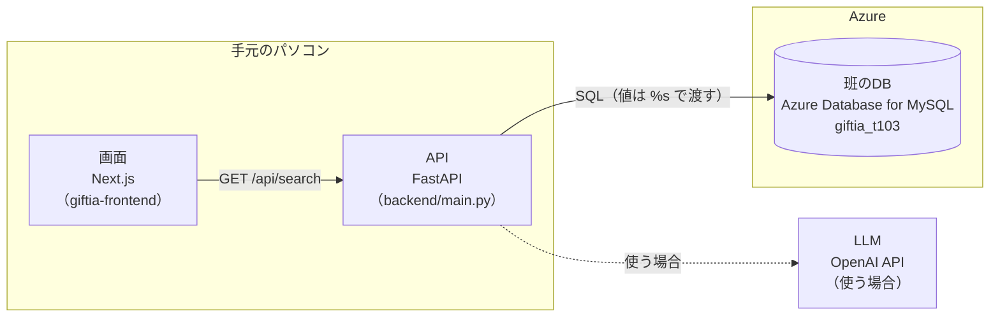

# 要件定義書

Tech0 Step3-1　Giftia ケース

Giftia「バースデーギフト改善」施策　― 何を、なぜこの構成・このロジックで作るか

| 項目 | 内容 |
| --- | --- |
| クラス名 | クラス1 |
| チーム名 | 3班_みっかんべー |
| メンバー | あかぷ、みかん、べー |
| 初版作成日 | 2026-11-06（3週目） |
| 最終更新日 | 6週目まで更新する |
| 対応する要求定義書 | クラス1_3班_みっかんべー_要求定義書 |
| 班のリポジトリ | <https://github.com/TanobeYuya/Step3-1_giftia-mikkanbe>（public） |

- 元ファイル: `要件定義書_テンプレート.docx` を Markdown に変換した
- 記号: `【未記入】` はまだ決めていない欄。`【要確認】` は確かめたい点がある欄。`（現状）` はいまのコードの状態で、施策で足す・変える前の起点
- 生成AIの利用: 各章の冒頭に書く（課題②の注意事項）
- この下書きの位置づけ: べーの要求定義書（顧客課題 D・案A）をもとにした下書き。3人の要求定義書を持ち寄って1つにまとめる前の、MTG（2026-11-07）用のたたき台。「（べー案）」の欄は合意前

## この書類の位置づけ

要求定義書で決めた要求を、何を・どう作るかに落とす書類です（IPA「ユーザのための要件定義ガイド」でいうシステム化要求定義にあたります）。

3週目に初版（3章・4.1・5章）を書き、実装しながら6週目まで更新します。細かな仕様（ワイヤーの精度・APIの全パターン・DDL・エラーコード）は求めません。

目標は「動くモックで、なぜこの構成・このロジックかを説明できる」こと。6週目の発表の「②要件定義書パート」は、この書類がそのまま骨格になります。

### 書き方の約束

- 「ガイド」の網掛け欄は、書き終えたら消してかまいません。灰色の文字は記入例なので、自分たちの内容に書き換えてください。
- 根拠を書く欄には、ケース資料のどこに書いてある事実か（例：Exhibit 2 Aさん、Exhibit 1 表2）を必ず添えてください。
- 生成AIを使ってかまいません。ただし、書いた内容を発表で自分の言葉で説明できることが前提です。

## 更新履歴

| 日付 | 更新した章 | 更新内容 | 更新者 |
| --- | --- | --- | --- |
| 2026-11-06 | 4.2・4.3・5.1・7・8・9（現状と固定の条件） | テンプレートを Markdown に変換。いまのコードとケース資料から分かる部分を記入 | べー |
| 2026-11-07 | 1〜6・9・10・付録A | 案A（贈る相手で探し、タグで見せる）を前提に、要求→要件、機能・画面・API、データ設計、候補の取り方と並び順を記入（べー案・MTG 前の下書き）。付録A から A の行を削除 | べー |
|  | 3・4.1・5 | 3週目：要求→要件（仮）、機能一覧、データ設計（ER図・追加データの定義・供給計画） |  |
|  | 1・2・4・6・9・10 | 4週目：範囲と Phase1、画面・API、候補の取り方と並び順、制約、実装できるかの判断。仮確定 |  |
|  | 7・8 | 5週目：技術選定理由と構成、非機能要件。確定 |  |
|  | 全体 | 6週目の前：実装とのずれを確認（付録B） |  |

## 1. システム化の範囲

記入する時期：4週目

- 生成AIの利用: -with。Exhibit 5 の必須処理を、いまのコードに当てはめた部分と、べーの案を表にした部分（Claude Code）

> ガイド：要求定義書の要求ID（BR-xx）のうち、今回システムで実現するものと、しないもの。
> Exhibit 5 の必須処理（入力を受ける → 商品DBから複数の候補を取得 → チームが設計したロジックで順位付け → 結果を返す）がどこに当たるかも書く。

（べー案）

| 要求ID | 今回システムで実現するか | 理由 |
| --- | --- | --- |
| BR-01 使う場面を想像できる | 一部を実現する | 贈る相手のタグと、同じ相手に贈られてきた商品を上に並べることで、手がかりを見せる。使う場面そのものを書いたレビューの表示（案C）は Phase2 |
| BR-02 比べて納得して決める | 一部を実現する | 結果カードのタグで候補どうしを比べられる。よい面と気になる面のレビューを並べる表示（案C）は Phase2 |
| BR-03 購入率 2.3% → 3.0% | システムでは実現しない（測る対象） | 購入率は、施策の結果として測る指標。Phase1 はモックで、本番の購入率は測れない（本番公開は対象外・Exhibit 5）。測り方は要求定義書 6章 |
| BR-04 商品部の工数の範囲で付け続ける | 実現する | 贈る相手は、レビュー本文から SQL のルールで付ける。商品部の手作業は要らない |

Exhibit 5 の必須処理と、いまのコードの対応（現状）

| 必須処理 | いまのコード | 施策で変えるか |
| --- | --- | --- |
| 入力を受ける | 画面の検索フォーム（`app/page.tsx`）→ `GET /api/search` のクエリ（q・category・indiv_wrap・price_min・price_max・limit） | 変える（べー案）：「贈る相手」と「シーン」の選択欄を足す（FR-01・FR-02） |
| 商品DBから複数の候補を取得 | `products` に WHERE で条件を足して取得（`backend/main.py`） | 変える（べー案）：シーンを選んだら product_scenes で絞る。贈る相手では絞らず、並び順に使う（FR-02・FR-03） |
| チームが設計したロジックで順位付け | `ORDER BY sales_count DESC, product_id`（販売数の多い順）。チーム独自のロジックはまだない | 変える（べー案）：選んだ相手に贈ったレビューの件数が多い順にし、同じなら販売数の多い順（FR-03。6.2） |
| 結果を返す | JSON を返し、結果カード（`app/ResultCard.tsx`）で表示 | 変える（べー案）：商品ごとにタグ（最大5個）を返し、結果カードに表示する（FR-04） |

## 2. 1〜3年後の姿と Phase1

記入する時期：4週目（6週目まで見直してよい）

- 生成AIの利用: -with。べーの案（案A → C → B の順位）をもとに、Claude Code が表にした

> ガイド：全部をやり切るのは無理という前提で、スコープを自分たちで切る。1〜3年後の全体像を描いたうえで、今回の実装をPhase1と位置づける。
> Giftiaは既にECが動いているので、Phase1は「EC全体」ではなく「今回の施策」の第1段。Phase1の目的は、要求定義書 6章の検証方法を確かめることにつなげる。

（べー案）

| 項目 | 内容 |
| --- | --- |
| 1〜3年後の姿 | どの相手・どのシーンでも、「同じ相手に贈った人」の声とタグから、相手が使う場面を想像して選べる。贈る相手と使う場面のデータは、レビューや購入後の声から自動で増えていく |
| Phase1 でやること | 案A。検索画面に「贈る相手」と「シーン」の選択欄を足す。選んだ相手に贈られてきた商品を上に並べ、結果カードにタグ（最大5個）を出す。贈る相手は「母（義母を含む）」から始める（312商品） |
| Phase1 でやらないことと理由 | 案C（同じ相手に贈った人のレビューを出すポップアップ）：レビューの感情の判定に生成AIが要り、工数が重い。案B（ベクトル検索）：改修の範囲が最も大きい。使う場面のタグ：説明文の文型がばらばらで、ルールでは抜けない。決済・実際の配送・本番公開・8,000商品すべてへのデータ付与は、開発条件で対象外（Exhibit 5） |
| Phase1 で検証すること（要求定義書 6章との対応） | タグと並び順だけで、母が使うかを想像できるか（6.4 のテストケースと、チーム内・身近な人での試用で確かめる）。要求定義書 6章は未記入のため、そろえるのは4週目 |
| Phase2 以降 | Phase2：案C のレビュー表示を足す（Phase1 でタグだけでは足りないと分かった場合を優先）。贈る相手を父・友人などへ広げる。Phase3：案B のあいまい検索、購入後アンケートで使う場面を集める |

## 3. 要求→要件マッピング

記入する時期：3週目（仮）。要件を足すたびに更新

- 生成AIの利用: -with。べーの案をもとに、Claude Code が要件に分けた

> ガイド：要求（BR）が、どの機能要件（FR）・データ要件（DR）・非機能要件（NFR）で実現されるかの対応表。ここが埋まっていないと、要求と作るものがつながっているかを誰も確かめられない。
> 1つの要求から複数の要件が生まれてよい。どの要求にもつながらない要件は、作る理由を見直す。要件は「作る人が判断でき、完成を確認できる」書き方にする（曖昧：友人に合う商品をおすすめする／具体：相手のタイプを選ぶと、対応するタイプ情報を持つ商品を決めた順位ルールで表示する）。

（べー案）

| 要求ID | 要求 | 要件ID | 要件（何を作るか） | 確認方法 |
| --- | --- | --- | --- | --- |
| BR-01 | 母がその商品を使う場面を想像できる | FR-01 | 検索画面で「贈る相手」を1つ選べる（未選択も可） | 画面で選び、API のクエリに recipient が付くことを確かめる |
| BR-01 | 母がその商品を使う場面を想像できる | FR-03 | 贈る相手を選ぶと、その相手に贈ったレビューの件数が多い商品から順に並ぶ | 6.4 のテストケース |
| BR-01・BR-02 | 母がその商品を使う場面を想像できる／候補を比べて納得して決める | FR-04 | 結果カードに、贈る相手・シーン・商品の性質のタグを、系統ごとに上位2〜3個、合わせて最大5個出す。「おすすめ」とは書かない | 6.4 のテストケースで、タグの数と並びを目で確かめる |
| BR-01 | 母がその商品を使う場面を想像できる | FR-02 | 検索画面で「シーン」を1つ選ぶと、そのシーンのタグを持つ商品に絞る | 選んだシーンのタグを持たない商品が結果に出ないこと |
| BR-01・BR-04 | 母がその商品を使う場面を想像できる／商品部の工数の範囲で付け続ける | DR-01 | 商品ごとに、贈った相手ごとのレビュー件数を product_facts に持つ | SQL で件数を確かめる（母・義母は 312商品の見込み） |
| BR-04 | 商品部の工数の範囲で付け続ける | DR-02 | DR-01 は SQL のルールで作り、新しいレビューが増えたら同じ SQL を流し直すだけで更新できる | SQL を2回流して、結果が同じになること |
| BR-01 | 母がその商品を使う場面を想像できる | NFR-01 | 贈る相手の付け方の精度：無作為に20件見て、誤りが2件以下 | ORDER BY RAND() で20件を目視 |
| BR-03 | 購入率 2.3% → 3.0% | （なし） | システムの要件ではなく、施策の結果として測る指標（1章） | 要求定義書 6章 |

## 4. 機能要件

記入する時期：4.1 は3週目、4.2・4.3 は4週目（実装しながら更新）

- 生成AIの利用: -with。4.2・4.3 の（現状）の行は、いまのコードから Claude Code が書き出した。4.1〜4.3 の（べー案）は、べーの案をもとに Claude Code が書いた

### 4.1 機能一覧

> ガイド：優先度「高」はPhase1で必ず作るもの。「中・低」は作れたら作るもの。

（べー案）

| ID | 機能名 | 概要 | 対応する要求ID | 優先度 |
| --- | --- | --- | --- | --- |
| FR-01 | 贈る相手の選択 | 検索画面に「贈る相手」の選択欄を足す。Phase1 の選択肢は「指定なし」「母（義母を含む）」。ほかの相手は、件数を確かめてから足す | BR-01 | 高 |
| FR-02 | シーンの選択 | 検索画面に「シーン」の選択欄を足す。選択肢は product_scenes の9種類（誕生日・送別・お礼・母の日・お歳暮・お中元・結婚祝い・父の日・出産祝い） | BR-01 | 中 |
| FR-03 | 贈る相手に合わせた並び順 | 選んだ相手に贈ったレビューの件数が多い順に並べる。相手を選ばないときは、いまと同じ販売数の多い順 | BR-01 | 高 |
| FR-04 | 結果カードのタグ表示 | 系統（贈る相手・シーン・商品の性質）ごとに上位2〜3個、合わせて最大5個のタグを出す。検索で選んだ条件に合うタグを先頭にする | BR-01・BR-02 | 高 |
| FR-05 | 同じ相手に贈った人のレビュー表示（案C） | 結果カードを押すとポップアップを開き、よい面と気になる面のレビューを1件ずつ出す。気になる面のレビューも必ず出す（気になる点が許容できるかを顧客が判断できるように）。レビューが1件もない商品は、両方の欄にまたがって「まだレビューがありません。」を薄く出す。片方だけない場合は「まだよかった点が書かれたレビューはありません。」「まだ気になる点が書かれたレビューはありません。」と分ける。本番に出したあと、両方出す場合と、よい面だけの場合を A/B テストで比べられるよう、表示を切り替えられる作りにする。比べる指標は購入率・満足度・返品率で、買ったあとの「やっぱりこれじゃなかった」という失望を減らせたかで判断する | BR-01・BR-02 | 低（Phase2） |

### 4.2 画面一覧

> ガイド：画面ごとに、何を入力し何を表示するか。ワイヤーフレームは手書きの写真や簡単な図で足りる（貼り付けてよい）。

| 画面名 | パス | 入力するもの | 表示するもの | 対応FR |
| --- | --- | --- | --- | --- |
| 検索画面（現状） | `/` | キーワード、カテゴリー、個包装のみ、価格の下限・上限 | 検索結果のカード（カテゴリー・ブランド・商品名・価格・評価・レビュー件数） | （現状） |
| 検索画面（べー案） | `/` | 現状の入力に、贈る相手（選択）とシーン（選択）を足す | 現状のカードに、タグを最大5個足す（例：「母」「誕生日」「母の日」「常温」） | FR-01〜FR-04 |

`/about` は Next.js の初期画面のままで、Giftia の画面ではない（現状）。

### 4.3 API一覧

> ガイド：フロント（Next.js）とバック（FastAPI）の約束。主なものだけでよく、全パターンは不要。
> 2週目の FastAPI 超Starter で作った検索 API を起点に、何を足す・変えるかを書く。

| エンドポイント | メソッド | 受け取るもの | 返すもの | 対応FR |
| --- | --- | --- | --- | --- |
| `/api/search`（現状） | GET | q（空白区切り。すべてを含む商品）、category、indiv_wrap（説明文に「個包装」）、price_min、price_max、limit（1〜100、既定20） | 該当件数と商品の配列（id・category・brand・name・price・rating・reviewCount）。販売数の多い順 | （現状） |
| `/api/health`（現状） | GET | なし | 接続中の DB 名と商品件数（動作確認用） | （現状） |
| `/api/search`（べー案） | GET | 現状の引数に、recipient（贈る相手。例：mother。空なら指定なし）と scene（シーンのタグ。空なら指定なし）を足す | 現状の項目に、tags（系統・名前・件数の配列。最大5個）を足す。並び順は 6.2 | FR-01〜FR-04 |

## 5. データ設計

記入する時期：3週目に初版（5.1 のER図は仮でよい）。班のDBに反映する前（4週目の冒頭）に仕上げる

- 生成AIの利用: -with。5.1 の基本ER図（現状）は、ケース資料 Exhibit 4 のテーブル一覧と、班のDBへの DESCRIBE の結果から Claude Code が描いた。5.2〜5.4 の（べー案）は、班のDBを調べた結果（要求定義書 5章の調査メモ）をもとに Claude Code が書いた

### 5.1 ER図（配布の基本ER図からの拡張）

> ガイド：配布された基本ER図（データ定義.md）に、自分たちが足すテーブル・カラムを書き加えた図を貼る。足した部分が分かるように色や線で区別する。
> 図はコードと一緒に変わる。実装で変えたら図も直す（6週目の前に付録Bで確認する）。

基本ER図（現状）。Exhibit 4 のテーブル一覧から描いた。列は主なものだけ。【要確認】配布の「データ定義.md」の基本ER図と照合する（キーの名前・関係は推測を含む）

施策で足すテーブル・カラム（べー案）: なし。product_facts に、fact の種類（贈った相手ごとのレビュー件数）を行として足すだけで、表の構造は変えない。足す fact は 5.2

### 5.2 追加するデータの定義

> ガイド：足すテーブル・カラムごとに、型と意味、取りうる値を書く。配布データにないもの（関係・好み・職場向きなど）を足す場合は、その定義を自分たちの言葉で決める。

（べー案）

| テーブル.カラム | 型 | 意味・定義 | 取りうる値 | 例 |
| --- | --- | --- | --- | --- |
| product_facts.fact ＝ 'review_to_mother'（足す fact の種類） | varchar(30) | その商品に、母・義母に贈ったと書かれたレビューがあること。レビュー本文に「母」を含み、「祖母」「叔母」「伯母」を含まないものを数える | 'review_to_mother'（Phase1）。父・友人などは件数を確かめてから足す | 'review_to_mother' |
| product_facts.value（上の行の値） | int | 母・義母に贈ったと書かれたレビューの件数 | 1以上の整数（0件の商品には行を作らない） | 3 |
| product_facts.source（上の行の値） | varchar(30) | 値の作り方 | 'review_rule'（レビュー本文からルールで作った） | 'review_rule' |

参考（ケース資料 Exhibit 4 の「構造化されていない情報」。検索や絞り込みに使えない情報の一覧）: 職場で渡しやすい、好みが分からない相手にも選びやすい、個性的／無難、気を遣わせにくい、実用的、みんなで分けられる、常温で保存できる、個包装かどうか、日持ち（賞味期限）、香りの有無・強さ、荷物になりにくい

### 5.3 データをどこに持たせたか

> ガイド：属性を商品側に持たせるか、会員・送り先の側に持たせるか。列で足すか、タグ用の別テーブルにするか。8,000件すべてに付けるか、一部にするか。
> 選ばなかった案と、選んだ理由を書く。

| 項目 | 内容 |
| --- | --- |
| 選んだ持たせ方 | （べー案）商品側に持たせる。既存の product_facts に1行ずつ足す（縦持ち：事実の種類を列ではなく行で増やす形）。母・義母に触れたレビューがある商品だけ（312商品の見込み） |
| 選ばなかった案 | ① products に列（例：mother_review_count）を足す。② 新しい表（例：product_recipients）を作る。③ 会員・送り先の側に持たせる |
| 理由 | product_facts は、常温・個包装など「商品の事実」を1行ずつ持つ表で、同じ形で足せる。表の構造を変えずに、相手の種類を増やせる。①は相手が増えるたびに列が増える。②は product_facts と役割が重なる。③は、レビューが商品について書かれているため、商品側に持たせるのが素直 |

### 5.4 データ供給計画

> ガイド：足したデータを、誰が・どうやって付け、新商品が入ったときにどう更新するか。年間どれだけの工数か（商品部が割けるのは月5人日程度・Exhibit 5）。
> 手作業・ルール・説明文やレビューからの推定・生成AI・購入後アンケートなどを組み合わせてよい。付け方の精度をどう確かめるかも書く。

（べー案）

| データ | 誰が | どうやって | 何件に | 新商品のとき | 年間の工数 | 精度の確かめ方 |
| --- | --- | --- | --- | --- | --- | --- |
| review_to_mother（母・義母に贈ったレビューの件数） | 開発（班） | reviews.comment に LIKE の条件をかけて、商品ごとに数える SQL を流す | 312商品の見込み（レビュー 425件） | レビューが付けば、同じ SQL を流し直すだけで付く。レビューがない新商品には付かない | 商品部：0人日（SQL を流すのは開発側。月1回で数分の見込み、未確認） | 無作為に20件を目視し、母・義母以外が混ざっていないかを数える。「叔母」の混入は条件で除いた |

## 6. 候補の取り方と並び順（検索・絞り込み・ランキング）

記入する時期：4週目（実装しながら更新）

- 生成AIの利用: -with。べーの案をもとに、Claude Code が並び順とテストケースを書いた

### 6.1 方式と選んだ理由

> ガイド：絞り込み（条件で候補を絞る）／並び順を変える（ルール・スコア）／LLM で提案する、のどれを使うか（組み合わせてもよい）。それぞれの説明のしやすさ・作りやすさ・費用と、選んだ理由。
> 要求定義書 5章で提案した案と合っているかを確かめる。

| 項目 | 内容 |
| --- | --- |
| 方式 | （べー案）絞り込み（シーン）と、並び順を変えるルール（贈る相手）の組み合わせ。LLM は使わない |
| 選んだ理由 | 要求定義書 5.3 の案A と同じ。並び順の理由をタグでそのまま説明できる（「母」のタグがあるから上にある）。データの大半が班のDBにあり、費用もかからない |
| 選ばなかった方式と理由 | 贈る相手での絞り込み：母・義母のレビューがある商品は 312件（全体の約3.9%）で、絞ると結果が少なくなりすぎる。LLM で提案：出力が毎回変わり、なぜその順かを説明しにくい。費用もかかる（案B に近い） |

### 6.2 候補の取り方と順位の付け方

> ガイド：候補取得：どの条件で商品DBから候補を取るか（絞り込み）。順位付け：どう並べるか。スコアなら式と重み、LLMならプロンプトの要点と渡すデータ。
> 「AIがいい感じに選ぶ」で止めない。同じ入力なら誰が読んでも同じ順位の考え方が分かるように書く。

| 項目 | 内容 |
| --- | --- |
| 入力（ユーザーから受け取るもの） | （べー案）現状の入力（キーワード・カテゴリー・個包装・価格）＋ 贈る相手（指定なし／母）＋ シーン（指定なし／9種類） |
| 候補取得の条件 | 現状の条件に加え、シーンを選んだら product_scenes にそのタグがある商品だけにする。贈る相手では絞らない |
| 順位付けのロジック | 贈る相手を選んだとき：① 選んだ相手に贈ったレビューの件数が多い順（Phase1 は母だけなので review_to_mother）（行がない商品は0件として後ろ）→ ② 販売数の多い順 → ③ 商品IDの順。選ばないとき：現状と同じ（販売数の多い順 → 商品ID） |
| 使うデータ（テーブル.カラム） | products（現状の列）、product_scenes.scene_tag、product_facts（fact・value。review_to_mother と、タグに使う room_temp・indiv_wrap・shelf_life_days） |

### 6.3 推薦理由

> ガイド：「なぜこの商品なのか」をどう作り、どう見せるか。顧客課題が選択への不安なら、理由を説明できること自体がプロダクトの価値になる。
> 絞り込みだけの案なら、どの条件で絞ったかをどう見せるかを書く。

| 項目 | 内容 |
| --- | --- |
| 理由の作り方 | （べー案）推薦の文は作らず、タグで理由を示す（「おすすめ」とは書かない）。タグは系統ごとに上位2〜3個、合わせて最大5個。並べる順は、① 検索で選んだ相手・シーンに合うタグ → ② 贈る相手（件数の多い順）→ ③ シーン → ④ 商品の性質（常温・個包装・賞味期限） |
| 表示の例 | 母・誕生日で検索したときの結果カード：［母 3件］［誕生日］［母の日］［常温］。件数を出すかは MTG で決める |

### 6.4 良し悪しの確かめ方（テストケース）

> ガイド：正解データがない中で、結果が妥当かを何で判断するか。状況を8〜10通り用意し、期待する結果と実際の結果を比べる。
> LLMを使う場合は、出力が毎回変わる前提で「何が満たされていれば合格か」を決めておく。

| No | 入力する状況 | 期待する結果（上位に来るべきもの・来てはいけないもの） | 実際の結果 | 判定 |
| --- | --- | --- | --- | --- |
| 1 | 贈る相手：母、ほかは指定なし | 上位は review_to_mother の件数が多い商品。1件目のカードの先頭タグが「母」 |  |  |
| 2 | 贈る相手：母、シーン：誕生日 | 全件が「誕生日」のタグを持つ。その中で母のレビューが多い順 |  |  |
| 3 | 贈る相手：母、シーン：母の日 | 全件が「母の日」のタグを持つ。上位に母のレビューがある商品 |  |  |
| 4 | 贈る相手：指定なし、シーン：指定なし | 現状と同じ順（販売数の多い順）。並びが変わっていない |  |  |
| 5 | 贈る相手：母、シーン：出産祝い | 結果は出産祝いのタグを持つ商品だけ。母のレビューがない商品ばかりでも、0件にならずに販売数の順で並ぶ |  |  |
| 6 | 贈る相手：母、キーワード：タオル | キーワードの条件を満たす商品だけ。その中で母のレビューが多い順 |  |  |
| 7 | 贈る相手：母、価格：3,000〜6,000円 | 価格の範囲外の商品が出ない。家族への誕生日の平均単価 5,400円（Exhibit 1 表2）の前後で候補が出る |  |  |
| 8 | 任意の検索 | どのカードもタグが5個以下。同じタグが重ならない。「おすすめ」の文字が出ない |  |  |
| 9 | 贈る相手：母 で上位20件のレビューを目視 | 上位の商品のレビューに、叔母・祖母・友人の母への言及だけの商品が入っていない |  |  |

## 7. 技術選定理由と構成

記入する時期：5週目（1〜5週目で学んだ技術ごとに1行ずつ足してよい）

- 生成AIの利用: -with。7.1 の構成図（現状）は、いまのコードの設定から Claude Code が描いた。選定理由は、開発条件で決まっている事実だけを書いた

> ガイド：「なぜその技術か」が核心。他の候補と比べて、今回の状況で何が決め手だったかを書く。
> 前工程で作ったStreamlitのアプリと比べて何が変わったかも、説明の材料になる。

| レイヤー | 技術 | 選定理由 | 比べた候補 |
| --- | --- | --- | --- |
| 画面（UI） | Next.js（手元のパソコンで動かす） | 開発条件で指定（Exhibit 5）。【未記入】自分たちの言葉での理由 | Streamlit など |
| API | FastAPI（手元のパソコンで動かす） | 開発条件で指定（Exhibit 5）。【未記入】 |  |
| データベース | Azure Database for MySQL（班のDB・開発環境） | 開発条件で「Exhibit 4 の現状データベース」と指定（Exhibit 5）。【未記入】 | SQLite など |
| LLM（使う場合） | OpenAI API | （べー案）Phase1 では使わない。贈る相手は SQL のルールで付けられ、並び順の理由をタグで説明できるため。Phase2 で案C（レビューの感情の判定）を作るときに使う | ルール・スコアのみ など |
| 公開（発展課題） | Azure（任意） | 【未記入】 | 今回は手元で動かす |

### 7.1 構成図

> ガイド：画面 → API → DB（→ LLM）のつながりと、それぞれがどこで動くか（手元のパソコン／Azure の班のDB）を図にして貼る。

構成図（現状）。【要確認】LLM を使うかは未定なので、点線で示す

## 8. 非機能要件

記入する時期：4週目に枠を決め、5週目に見直す

- 生成AIの利用: -with。セキュリティの行は、いまのコードの実装とテンプレートの必須事項から Claude Code が書いた。ほかは開発条件の事実だけ

> ガイド：IPA「非機能要求グレード」の6つの大項目を枠にする。今回必要なものだけ書き、書かない項目は「対象外」とその理由を書く（本番公開は対象外・Exhibit 5）。
> セキュリティは必ず書く：DBの接続情報と API キーの置き場所（.env に置き、GitHub にコミットしない・画面側に置かない）、班のDBは開発環境で本番ではないこと、個人情報を持たないこと。

| 大項目 | 今回の要件 | 目標値・方針 | 対象外にした場合の理由 |
| --- | --- | --- | --- |
| 可用性 | 【要確認】対象外とするか |  | 本番公開は対象外（Exhibit 5）。手元で動かすモックのため |
| 性能・拡張性 | 【未記入】 | 【未記入】（例：検索の応答時間） |  |
| 運用・保守性 | 【未記入】 | 【未記入】 |  |
| 移行性（追加データの投入、本番のDBへの反映） | 【未記入】 | 【未記入】 |  |
| セキュリティ | DB の接続情報と API キーは `.env` に置き、GitHub にコミットしない（`.gitignore` で除外）。画面側（Next.js）に置かない。SQL の値はプレースホルダー（%s）で渡し、文字列に直接つなげない（SQL インジェクション対策）。ブラウザから API を呼べるのは、`.env` の CORS_ORIGINS に書いた画面の URL だけ（CORS。ブラウザ以外からの呼び出しは防げないので、認証の代わりにはならない） | 班の DB は開発環境で、本番ではない。データはダミーで、個人情報を持たない（Exhibit 4） |  |
| システム環境・エコロジー | 【要確認】対象外とするか |  | 【未記入】 |

## 9. 制約条件

記入する時期：4週目

- 生成AIの利用: -with。ケース資料の開発条件から Claude Code が転記した

> ガイド：守らなければならない条件（Exhibit 5）と、講座の条件。制約から逆算して決めたことがあれば書く。

| 項目 | 内容 |
| --- | --- |
| 期間 | 2か月（要求・要件を固めて提案する。実装は一部でよい） |
| 人員 | 班のメンバー3人（あかぷ、みかん、べー） |
| 社内の工数 | 商品部：月5人日程度／編集チーム：月10人日程度 |
| 技術 | Next.js・FastAPI・現状データベース（班の Azure MySQL）・Azure |
| 費用 | （べー案）Phase1 は LLM を使わないため、追加の利用料はかからない。Phase2 で使う場合の上限は、そのときに決める |
| 引き継ぎ先 | 開発部（外部の開発メンバーを含む）。要求定義書・要件定義書で引き継ぐ（Exhibit 5） |
| 対象外 | 決済、実際の配送、本番公開、8,000商品すべてへのデータ付与（Exhibit 5） |

## 10. 実装できるかの判断

記入する時期：4週目（5週目に見直す）

- 生成AIの利用: -with。べーの案と班のDBを調べた結果をもとに、Claude Code が書いた

> ガイド：講師の関門はない。実装できるかは自分たちで判断し、その根拠をここに残す。無理だと分かって範囲を縮めたら、その判断も書く。

（べー案。4週目に見直す）

| 観点 | 判断 | 根拠 |
| --- | --- | --- |
| データは用意できるか | できる見込み | 母・義母への言及があるレビューは 425件・312商品（SQL で集計）。シーンのタグと商品の事実（常温など）は班のDBにある |
| 期間内に作れるか | できる見込み | 変えるのは /api/search の引数と並び順、検索画面の選択欄、結果カードのタグ。表の構造は変えない。生成AIを使わない |
| 候補の取り方と並び順は具体的に書けているか | 書けている（仮） | 6.2 に、絞り込みの条件と順位の付け方（①相手のレビュー件数 → ②販売数 → ③商品ID）を書いた |
| データ供給は続くか | 続く見込み | SQL を流し直すだけで更新でき、商品部の手作業は要らない（5.4） |
| 1〜3年後の姿に対して、Phase1で何を検証するか | タグと並び順だけで、母が使うかを想像できるか | 想像できなければ、Phase2 で案C（同じ相手に贈った人のレビュー表示）を足す |

## 付録A. 残課題とリスク

記入する時期：随時

- 生成AIの利用: -with。1027 課題①のチーム投稿「弱いところ」から Claude Code が転記した

| 内容 | 影響 | 対応（いつ・誰が） |
| --- | --- | --- |
| ヒアリングは各シーン1名で、顧客課題の確度は中程度 | 採用した課題が、そのシーンの多くの顧客に当てはまらない可能性 | 【未記入】 |
| 詰まりと購入率の関係は、シーン単位の傾向で、因果は未検証 | 施策で詰まりを解いても、購入率が上がらない可能性 | 【未記入】 |
| D の決め手は母の発言の想起（サイトの外）で、サイト内の改善で行動が変わるかは未確認 | 施策が効かない可能性 | 【未記入】 |
| 贈る相手は LIKE のルールで付けるため、誤りが混ざる（「叔母」が「母」に当たる誤りは見つけて除いた） | 母以外に贈った商品が上位に出る | （べー案）無作為20件の目視で確かめる（NFR-01・6.4 No.9） |
| タグが付くのは 312商品（全体の約3.9%）で、多くの商品はタグなしのまま | 到達率が低く、購入率への効果が小さい可能性 | （べー案）Phase1 は効果の大きさではなく、タグで想像できるかを確かめる。広げ方は Phase2 |
| レビュー本文は決まった言い回しの組み合わせで、演習用に作られたデータの可能性がある | 本番のレビューでは、同じルールで相手を抜けない可能性 | （べー案）本番に移すときに、実データで抜け方を確かめる（移行時） |

## 付録B. 実装とのずれの確認

記入する時期：6週目の前

- 生成AIの利用: なし（未記入）

> ガイド：Word の図や表はコードと自動ではそろわない。発表の前に、書類と実装が一致しているかを確かめ、直した箇所を更新履歴に残す。

| 確認すること | 一致しているか | 直したこと |
| --- | --- | --- |
| ER図・データ定義（5章）と実際のテーブル |  |  |
| API一覧（4.3）と実際のエンドポイント |  |  |
| 候補の取り方と並び順（6章）と実際のコード |  |  |
| テストケース（6.4）の実際の結果 |  |  |
| 構成図（7.1）と実際に動かした構成（手元／Azure） |  |  |
